# Guía 1 – Producto 1: Plan de Análisis y Trazabilidad de Requisitos – SIGMAVITAL

## 1. Datos de la entrega

| Campo | Valor |
|---|---|
| **Ficha** | 3413974 |
| **Proyecto** | SIGMAVITAL – Sistema Gestor de Ambulancias (SGA) |
| **Aprendiz (usuario GitHub)** | `miguel18100` |
| **Fecha de entrega / actualización** | 2026-11-28 |
| **Versión / commit de referencia** | Línea base consolidada posterior a `ca43b76` |

---

## 2. Qué se corrigió o completó

Partiendo de los avances iniciales del repositorio y del documento SRS oficial del sistema SIGMAVITAL, en esta entrega se completó el levantamiento de análisis con los **65 requisitos funcionales (`RF-001` a `RF-065`)**, **29 requisitos no funcionales (`RNF-001` a `RNF-029`)** y **18 reglas de negocio (`RN-001` a `RN-018`)** distribuidos en los 15 módulos del proyecto. Adicionalmente, se sincronizó al 100 % la matriz de requisitos con los **20 casos de uso UML** del diagrama, manteniendo la convención verbo + objeto sin jerga tecnológica, e incorporando las justificaciones explícitas de las relaciones `«include»` y `«extend»` junto con la limpieza de enlaces y archivos de respaldo previos.

---

## 3. Reutilización de material previo

| Artefacto previo en este repositorio | Ruta de origen | Qué se tomó de él | Qué se ajustó para SIGMAVITAL |
|---|---|---|---|
| Instrumentos completos del SGA | `../../../../../03-execute/08-week/02-optional-activity/Complete-SGA-Instruments/Instrumentos_SGA_Completos (1) (1).docx` | Roles iniciales, flujo base de solicitudes, ambulancias y reglas de habilitación | Se amplió y formalizó al estándar completo de 65 RF, 29 RNF y 18 RN del SRS unificado |
| Normativa y mockups base del proyecto SGA | `../../../../../03-execute/14-week/02-optional-activity/Normativa_Proyecto_SGA_Completa.docx` | Contexto normativo de Resolución 3100/2017 y operación prehospitalaria | Se estructuraron los módulos de facturación, propietarios, proveedores, visitantes, PQRS, documental y auditoría |
| Primera versión del análisis de metodologías y planificación | `9eb23e5` y `1c89366` (historial Git en `G1-P1-Plan-Analisis`) | Selección de metodología híbrida y estructura base de carpetas `01` a `06` | Se actualizaron los estados del plan a completado y se alineó la caracterización al alcance total del SRS |

---

## 4. Evidencias incluidas (links)

- [Caracterización de la solución](01-caracterizacion-solucion/Caracterizacion-Solucion.md) — problemática prehospitalaria, alcance en los 15 módulos (65 RF) y perfilamiento de los 6 actores del sistema.
- [Comparación de metodologías](02-comparacion-metodologias/Comparacion-Metodologias.md) — análisis multicriterio entre metodologías tradicionales y ágiles.
- [Selección y justificación metodológica](03-seleccion-metodologia/Seleccion-y-Justificacion-Metodologia.md) — justificación del enfoque híbrido iterativo aplicado a SIGMAVITAL.
- [Plan de actividades](04-plan-actividades/Plan-de-Actividades.md) — cronograma actualizado de actividades de análisis y entregables completados.
- [Matriz de requisitos y casos de uso](05-matriz-requisitos-casos-uso/Matriz-Requisitos-Casos-Uso.md) — trazabilidad completa **65/65 RF**, **29/29 RNF**, **18/18 RN**, catálogo `CU-01` a `CU-20` y justificación de relaciones `«include»`/`«extend»`.
- [Diagrama de casos de uso editable (.drawio)](06-diagrama-casos-uso/Diagrama-Casos-Uso.drawio) — fuente editable con 5 paquetes, 20 casos de uso, 6 actores externos y líneas ortogonales sin cruces.
- [Diagrama de casos de uso exportado (.svg)](06-diagrama-casos-uso/Diagrama-Casos-Uso.svg) — exportación vectorial fiel 1:1 del archivo `.drawio`.
- [Vista previa del diagrama (.png)](06-diagrama-casos-uso/Diagrama-Casos-Uso.drawio.png) — captura visual de respaldo sincronizada con el `.drawio`.

### Vista rápida del diagrama de casos de uso

---

## 5. Cómo verificar que funciona

1. **Verificación de cobertura SRS (65/65 RF):** abrir [Matriz-Requisitos-Casos-Uso.md](05-matriz-requisitos-casos-uso/Matriz-Requisitos-Casos-Uso.md) y comprobar que cada código de `RF-001` a `RF-065` tiene un caso de uso asignado dentro del rango `CU-01` a `CU-20`.
2. **Verificación de sincronización matriz ↔ diagrama:** comparar los 20 casos de uso listados en la sección 4 de la matriz contra los óvalos contenidos en [Diagrama-Casos-Uso.drawio](06-diagrama-casos-uso/Diagrama-Casos-Uso.drawio) y [Diagrama-Casos-Uso.svg](06-diagrama-casos-uso/Diagrama-Casos-Uso.svg).
3. **Verificación de calidad UML:** comprobar que todos los actores se ubican fuera de la frontera del sistema, que todos los nombres siguen verbo + objeto sin términos tecnológicos y que cada `«include»`/`«extend»` posee justificación explícita en la sección 5 de la matriz.
4. **Continuidad hacia el Producto 2:** validar que los casos críticos `CU-08`, `CU-11` y `CU-14` enlazan directamente con [G1-P2-Modelado-SIGMAVITAL](../G1-P2-Modelado-SIGMAVITAL/README.md).

---

## 6. Ajustes realizados tras verificación

| # | Qué estaba mal o incompleto | Qué se corrigió | Commit / fecha |
|---|---|---|---|
| 1 | La matriz inicial cubría 28 requisitos resumidos y 18 casos de uso desactualizados | Se integraron los **65 RF, 29 RNF y 18 RN** completos del SRS mapeados a **20 casos de uso** sin inflación CRUD | `8149f92` / 2026-11-28 |
| 2 | El README anterior presentaba dos enlaces rotos (`./07-evidencias/` y `./08-informe/`) y una línea base sin formato completo | Se reestructuró `README.md` conforme a la plantilla oficial con enlaces locales 100 % válidos y tabla real de reutilización | 2026-11-28 |
| 3 | Persistían archivos temporales (`precorreccion.drawio`, `respaldo.puml`) y faltaba exportación `.svg` directa y justificación de `«include»`/`«extend»` | Se eliminaron los respaldos obsoletos, se regeneró el diagrama `.drawio` + `.svg` + `.png` ortogonal limpio y se documentaron todas las relaciones en la matriz | 2026-11-28 |

---

## 7. Autoría y uso de IA

- **Autor principal y responsable técnico:** `miguel18100` (análisis de requisitos, validación de trazabilidad completa, organización documental y verificación visual de diagramas).
- **Apoyo de IA:** se utilizó **ChatGPT** exclusivamente como asistente de redacción estructurada, revisión de formato Markdown y apoyo en validación de consistencia de tablas; toda decisión de alcance, regla de negocio y verificación final de entregables fue revisada y aprobada por el aprendiz.
