# DA-01 – Diagrama de Actividades: Registrar Solicitud y Clasificar Prioridad

**Caso de uso asociado:** `CU-08` (RF-021, RN-002)  
**Diagrama editable (.drawio):** [DA-01-Registrar-Solicitud-CU08.drawio](DA-01-Registrar-Solicitud-CU08.drawio)  
**Vector SVG (.svg):** [DA-01-Registrar-Solicitud-CU08.svg](DA-01-Registrar-Solicitud-CU08.svg)  
**Vista previa (.png):** [DA-01-Registrar-Solicitud-CU08.png](DA-01-Registrar-Solicitud-CU08.png)

## 1. Carriles (Actores y componentes)
- **Coordinador Operativo**
- **Sistema SGA**

## 2. Decisiones y guardas de control
- `¿Datos completos?` -> `[Válidos]` / `[Incompletos]`
- `¿Coherencia clínica RN-002?` -> `[Consistente]` / `[Inconsistencia]`
- `¿Registrar paciente ahora?` -> `[Con datos de paciente]` (`«extend» CU-09`) / `[Solo solicitud]`

## 3. Concurrencia / Sincronización
Flujo secuencial validado con ciclo de corrección controlada ante campos faltantes.

## 4. Vista del diagrama

