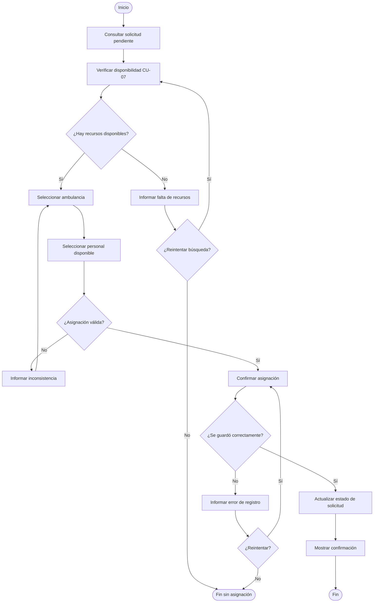

# DA-02 – Asignar ambulancia y personal (CU-11)

**Proyecto:** SIGMAVITAL  
**Requisito relacionado:** RF-17 / RF-18  
**Caso de uso:** CU-11 – Asignar ambulancia y personal  
**Actor principal:** Coordinador operativo  
**Estado:** Diseño preliminar

## Diagrama de actividades

## Descripción

El diagrama representa el proceso de asignación de ambulancia y personal a una solicitud de servicio. El coordinador consulta la solicitud pendiente y verifica la disponibilidad de recursos mediante el caso de uso CU-07. Si existen recursos disponibles, selecciona la ambulancia y el personal requerido, y el sistema valida que la asignación sea consistente.

Si no hay recursos disponibles, el coordinador puede reintentar la búsqueda o finalizar sin asignación. Cuando la asignación es válida, se confirma y se guarda. Si ocurre un error de almacenamiento, se permite reintentar. Finalmente, el sistema actualiza el estado de la solicitud y presenta la confirmación.

## Trazabilidad

| Elemento | Referencia |
|---|---|
| Requisitos funcionales | RF-17 / RF-18 |
| Caso de uso | CU-11 |
| Caso de uso incluido | CU-07 |
| Diagrama | DA-02 |
| Pantalla asociada | P-02 |
| Clase conceptual principal | Asignación / Ambulancia / Personal |
| Actor principal | Coordinador operativo |
| Estado | Diseño preliminar |
