# DA-02 – Diagrama de Actividades: Asignar Ambulancia y Personal

**Caso de uso asociado:** `CU-11` (RF-022, RF-023, RN-001..004, RN-007)  
**Diagrama editable (.drawio):** [DA-02-Asignar-Ambulancia-CU11.drawio](DA-02-Asignar-Ambulancia-CU11.drawio)  
**Vector SVG (.svg):** [DA-02-Asignar-Ambulancia-CU11.svg](DA-02-Asignar-Ambulancia-CU11.svg)  
**Vista previa (.png):** [DA-02-Asignar-Ambulancia-CU11.png](DA-02-Asignar-Ambulancia-CU11.png)

## 1. Carriles (Actores y componentes)
- **Coordinador Operativo**
- **Sistema SGA (Motor Estrategia y Reglas)**
- **Recurso y Auditoría**

## 2. Decisiones y guardas de control
- `¿Unidad y tripulación habilitados?` -> `[Disponibles]` / `[Sin recursos vigentes]`
- `¿Usar sugerencia o manual?` -> `[Sugerencia aceptada]` / `[Selección manual]`
- `¿Motivo manual válido (RN-007)?` -> `[Motivo válido]` / `[Vacío / E1]`

## 3. Concurrencia / Sincronización
Bloque **Fork / Join** al confirmar despacho: registra paralelamente la asignación N:M, cambia estados de ambulancia/personal y servicio, y consolida la bitácora inmutable de auditoría.

## 4. Vista del diagrama

