# DA-03 – Diagrama de Actividades: Realizar Cierre Formal del Servicio

**Caso de uso asociado:** `CU-14` (RF-025, RF-031, RN-005, RN-010, RN-014)  
**Diagrama editable (.drawio):** [DA-03-Cerrar-Servicio-CU14.drawio](DA-03-Cerrar-Servicio-CU14.drawio)  
**Vector SVG (.svg):** [DA-03-Cerrar-Servicio-CU14.svg](DA-03-Cerrar-Servicio-CU14.svg)  
**Vista previa (.png):** [DA-03-Cerrar-Servicio-CU14.png](DA-03-Cerrar-Servicio-CU14.png)

## 1. Carriles (Actores y componentes)
- **Paramédico / Tripulación**
- **Sistema SGA**
- **Finanzas y Auditoría**

## 2. Decisiones y guardas de control
- `¿Campos RN-005 completos?` -> `[Completos]` / `[Incompletos]`
- `¿Confirmación aprobada?` -> `[Confirmado]` / `[Cancelado por usuario]`

## 3. Concurrencia / Sincronización
Bloque **Fork / Join** tras confirmar el cierre: persiste el registro de cierre y estado `Finalizado`, libera simultáneamente ambulancia y personal a `Disponible`, emite la factura inmutable (`CU-15`) y graba el evento en auditoría.

## 4. Vista del diagrama

