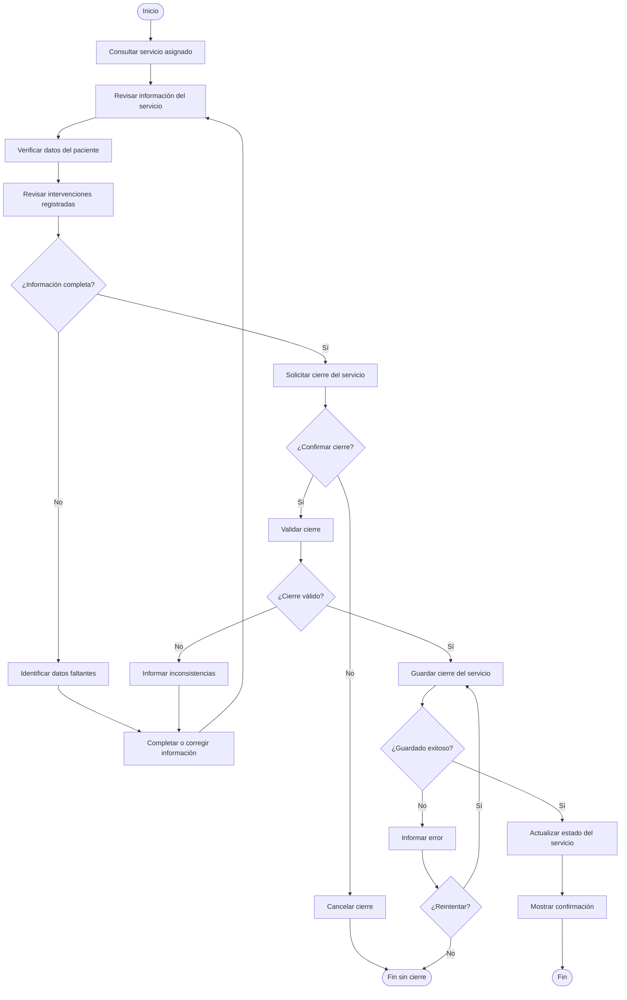

# DA-03 – Cerrar servicio (CU-22)

**Proyecto:** SIGMAVITAL
**Requisito relacionado:** RF-31
**Caso de uso:** CU-22 – Cerrar servicio
**Actor principal:** Coordinador operativo
**Estado:** Diseño preliminar

## Diagrama de actividades

## Descripción

El diagrama representa el proceso de cierre de un servicio de ambulancia. El coordinador consulta el servicio y revisa la información registrada, incluyendo los datos del paciente y las intervenciones realizadas. Si la información está incompleta, identifica los datos faltantes y realiza las correcciones necesarias antes de continuar.

Cuando la información está completa, el coordinador solicita y confirma el cierre. El sistema valida los datos y, si encuentra inconsistencias, las informa para que puedan corregirse. Si la validación es satisfactoria, el sistema guarda el cierre y actualiza el estado del servicio. En caso de error de almacenamiento, permite reintentar o abandonar el proceso sin confirmar el cierre.

## Trazabilidad

| Elemento | Referencia |
|---|---|
| Requisito funcional | RF-31 |
| Caso de uso | CU-22 |
| Diagrama | DA-03 |
| Pantalla asociada | P-03 |
| Clase conceptual principal | Servicio / Paciente / Intervención |
| Actor principal | Coordinador operativo |
| Estado | Diseño preliminar |
