# MD-01 – Modelo Conceptual de Dominio – SIGMAVITAL (SGA)

**Versión:** 2.0  
**Diagrama editable (.drawio):** [MD-01-Modelo-Dominio.drawio](MD-01-Modelo-Dominio.drawio)  
**Vector SVG (.svg):** [MD-01-Modelo-Dominio.svg](MD-01-Modelo-Dominio.svg)  
**Vista previa (.png):** [MD-01-Modelo-Dominio.png](MD-01-Modelo-Dominio.png)

## 1. Propósito y reglas del modelo conceptual

Representa los conceptos clave del negocio de atención prehospitalaria de SIGMAVITAL **sin incluir métodos, claves foráneas (`id_*`) ni tipos técnicos de base de datos (`VARCHAR`, `INT`, `UUID`)**. Modela explícitamente la herencia conceptual de categorías REPS (`Ambulancia` -> `AmbulanciaTAB` y `AmbulanciaTAM`) y la clase de asociación `AsignacionPersonal`.

## 2. Catálogo completo de conceptos de dominio (25 conceptos)

| # | Concepto | Responsabilidad en el dominio | Atributos conceptuales clave |
|---|---|---|---|
| 1 | `Rol` | Perfil de permisos RBAC en el SGA | nombre, descripcion |
| 2 | `Usuario` | Cuenta autenticada y política de seguridad | nombreCompleto, correoElectronico, estadoCuenta, intentosFallidos, bloqueadoHasta |
| 3 | `PropietarioUnidad` | Propietario vinculado a la flota | identificacion, razonSocial, tipoVinculacion, estado |
| 4 | `Ambulancia` | Unidad asistencial base (`TAB` / `TAM`) | numeroUnidad, placa, habilitacionREPS, vigenciaSOAT, estadoOperativo, estadoContractual |
| 5 | `AmbulanciaTAB` | Especialización de Transporte Asistencial Básico | dotacionBasicaREPS, soporteVitalBasico |
| 6 | `AmbulanciaTAM` | Especialización de Transporte Asistencial Medicalizado | equipamientoUCI, requiereMedicoBordo |
| 7 | `MantenimientoUnidad` | Registro preventivo o correctivo de flota | tipoMantenimiento, fechaRegistro, costo, descripcion |
| 8 | `Personal` | Talento humano prehospitalario habilitado | nombreCompleto, perfilOperativo, tarjetaProfesional, vigenciaCertificacion, horasTurnoContinuas |
| 9 | `Paciente` | Persona atendida o trasladada | identificacion, nombreCompleto, fechaNacimiento, estadoClinicoInicial, telefonos (conjunto) |
| 10 | `Solicitud` | Requerimiento inicial de emergencia o traslado | fechaHoraSolicitud, direccionEvento, coordenadasGPS, prioridadClinica, estado |
| 11 | `Servicio` | Ejecución clínica y operativa de una atención | fechaHoraInicio, fechaHoraCierre, estadoServicio, destinoTraslado, estadoPacienteFinal |
| 12 | `Asignacion` | Despacho de ambulancia asignado al servicio | fechaHoraAsignacion, criterioDespacho, esManual, motivoManual, estado |
| 13 | `AsignacionPersonal` | Clase de asociación entre asignación y tripulante | rolEnTripulacion, fechaVinculacion |
| 14 | `Intervencion` | Actuación asistencial registrada durante el servicio | fechaHora, tipoIntervencion, descripcionClinica |
| 15 | `RegistroCierre` | Consolidación clínica obligatoria de cierre (RN-005) | fechaHoraCierre, resultadoAtencion, destinoFinal, responsableAtencion |
| 16 | `Factura` | Documento contable inmutable emitido al cierre | numeroFactura, valorTotal, diasMora, esInmutable, estadoPago |
| 17 | `NotaContable` | Ajuste crédito o débito justificado (RN-014) | tipoNota, valorAjuste, motivoJustificado |
| 18 | `MovimientoFinanciero` | Ingreso o egreso soportado en cartera | tipoMovimiento, monto, fechaRegistro |
| 19 | `Proveedor` | Tercero externo de insumos o mantenimiento | nit, razonSocial, tipoServicio, estado |
| 20 | `ContratoProveedor` | Acuerdo vigente evaluable con proveedor | numeroContrato, objeto, fechaVencimiento, calificacion |
| 21 | `Visitante` | Persona externa controlada en sede física | documento, nombreCompleto, preautorizado, justificacionManual |
| 22 | `Pqrs` | Solicitud ciudadana con plazo normativo | codigoRadicado, tipoPqrs, fechaLimite, respuestaFormal |
| 23 | `Documento` | Archivo institucional clasificado y versionado | titulo, version, hashSha256, confidencialidad, esOficial |
| 24 | `NovedadOperativa` | Incidencia operativa con resolución documentada | tipoNovedad, prioridad, resolucionDocumentada, estado |
| 25 | `Auditoria` | Traza cronológica inalterable de acciones (RN-010) | modulo, accion, valoresPrevios, valoresNuevos, fechaEvento |

## 3. Relaciones y multiplicidades verificadas (origen -> destino)

| Origen | Multiplicidad origen | Verbo | Multiplicidad destino | Destino | Regla clave |
|---|---:|---|---:|---|---|
| `Rol` | `1` | agrupa | `0..*` | `Usuario` | Un rol puede agrupar múltiples usuarios; cada cuenta tiene un rol principal |
| `Usuario` | `1` | registra | `0..*` | `Solicitud` | Toda solicitud registra qué usuario la ingresó |
| `PropietarioUnidad` | `1` | posee | `0..*` | `Ambulancia` | Cada unidad pertenece a un propietario activo (RF-045) |
| `Ambulancia` | `1` | recibe | `0..*` | `MantenimientoUnidad` | Historial preventivo/correctivo de cada unidad (RF-012) |
| `AmbulanciaTAB / TAM` | — | hereda (`es un`) | — | `Ambulancia` | Generalización según categoría REPS TAB/TAM |
| `Solicitud` | `1` | origina | `0..1` | `Servicio` | Cada solicitud válida origina un servicio prehospitalario |
| `Paciente` | `1` | recibe atención | `0..*` | `Servicio` | Un paciente conserva su identidad independiente de los servicios |
| `Servicio` | `1` | contiene (composición) | `0..*` | `Intervencion` | Las intervenciones existen dentro del ciclo de un servicio |
| `Servicio` | `1` | requiere (composición) | `0..*` | `Asignacion` | Las asignaciones pertenecen al ciclo del servicio |
| `Ambulancia` | `1` | cubre | `0..*` | `Asignacion` | Bloqueando solapamientos simultáneos (RN-001) |
| `Asignacion` | `0..*` | tripulada por (`AsignacionPersonal`) | `1..*` | `Personal` | Tripulación vinculada mediante clase de asociación |
| `Servicio` | `1` | consolida (composición) | `0..1` | `RegistroCierre` | Solo un cierre formal definitivo por servicio (RN-005) |
| `RegistroCierre` | `1` | genera | `0..1` | `Factura` | Emisión contable automática e inmutable al cierre (RN-014) |
| `Factura` | `1` | ajusta mediante | `0..*` | `NotaContable` | Correcciones exclusivamente vía nota crédito/débito |
| `Proveedor` | `1` | suscribe | `0..*` | `ContratoProveedor` | Contratos vigentes con alertas 30/15/5 días (RN-012) |

## 4. Vista del diagrama conceptual

