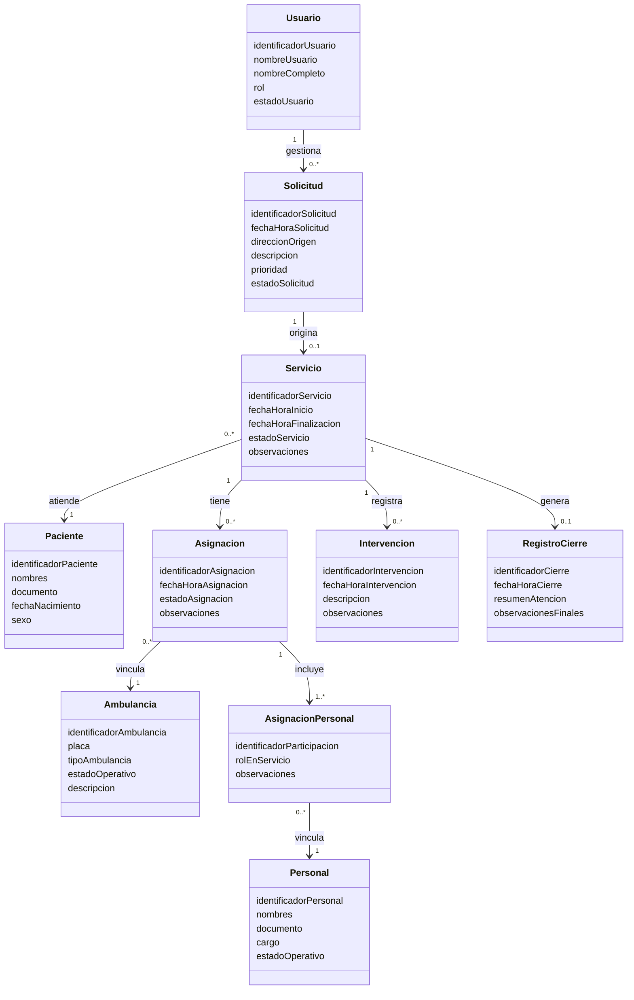

## 5. Clases conceptuales y atributos

### 5.1 Solicitud

Representa la solicitud de atención que origina la gestión operativa del servicio de ambulancia.

| Atributo | Descripción |
|---|---|
| identificadorSolicitud | Identificador de la solicitud |
| fechaHoraSolicitud | Fecha y hora de registro |
| direccionOrigen | Ubicación donde se requiere el servicio |
| descripcion | Motivo reportado para la atención |
| prioridad | Nivel de prioridad asignado |
| estadoSolicitud | Estado de la solicitud |

### 5.2 Servicio

Representa la atención operativa de ambulancia asociada a una solicitud.

| Atributo | Descripción |
|---|---|
| identificadorServicio | Identificador del servicio |
| fechaHoraInicio | Fecha y hora de inicio |
| fechaHoraFinalizacion | Fecha y hora de finalización |
| estadoServicio | Estado operativo del servicio |
| observaciones | Observaciones registradas al finalizar |

### 5.3 Paciente

Representa a la persona que recibe la atención durante el servicio.

| Atributo | Descripción |
|---|---|
| identificadorPaciente | Identificador del paciente |
| nombres | Nombres del paciente |
| apellidos | Apellidos del paciente |
| documento | Documento de identificación |
| fechaNacimiento | Fecha de nacimiento |
| datosContacto | Información de contacto |

### 5.4 Ambulancia

Representa el vehículo destinado a la prestación de servicios de atención.

| Atributo | Descripción |
|---|---|
| identificadorAmbulancia | Identificador de la ambulancia |
| placa | Placa del vehículo |
| codigoInterno | Código interno de identificación |
| tipoAmbulancia | Tipo o clasificación de ambulancia |
| estadoOperativo | Estado de disponibilidad operativa |
| kilometraje | Kilometraje registrado |

### 5.5 Personal

Representa a los integrantes del equipo operativo que participan en la prestación del servicio.

| Atributo | Descripción |
|---|---|
| identificadorPersonal | Identificador del integrante |
| nombres | Nombres del integrante |
| documento | Documento de identificación |
| cargo | Función desempeñada |
| estadoOperativo | Estado de disponibilidad |

### 5.6 Asignación

Representa la asignación operativa de una ambulancia a un servicio. Permite registrar información propia del evento de asignación y relacionar la participación del personal mediante AsignacionPersonal.

| Atributo | Descripción |
|---|---|
| identificadorAsignacion | Identificador de la asignación |
| fechaHoraAsignacion | Fecha y hora de asignación |
| estadoAsignacion | Estado de la asignación |
| observaciones | Observaciones de la asignación |

### 5.7 Intervención

Representa las acciones o procedimientos realizados durante la atención del paciente.

| Atributo | Descripción |
|---|---|
| identificadorIntervencion | Identificador de la intervención |
| fechaHoraIntervencion | Fecha y hora de registro |
| descripcion | Descripción de la intervención |
| observaciones | Observaciones asociadas |

### 5.8 Registro de cierre

Representa la información documental asociada al cierre del servicio.

| Atributo | Descripción |
|---|---|
| identificadorCierre | Identificador del registro de cierre |
| fechaHoraCierre | Fecha y hora de cierre |
| resumenAtencion | Resumen de la atención realizada |
| observacionesFinales | Observaciones finales |

### 5.9 Usuario

Representa a la persona que utiliza el sistema para gestionar las operaciones.

| Atributo | Descripción |
|---|---|
| identificadorUsuario | Identificador del usuario |
| nombreUsuario | Nombre de usuario |
| nombreCompleto | Nombre completo |
| rol | Rol dentro del sistema |
| estadoUsuario | Estado del usuario |

### 5.10 AsignacionPersonal

Representa la participación de un integrante del personal en una asignación operativa. Esta clase de asociación permite registrar información propia de la participación.

| Atributo | Descripción |
|---|---|
| identificadorParticipacion | Identificador de la participación |
| rolEnServicio | Función desempeñada dentro de la asignación |
| fechaHoraVinculacion | Fecha y hora de vinculación del integrante |

## 6. Asociaciones y multiplicidades

Las siguientes asociaciones representan las relaciones conceptuales propuestas entre las clases del modelo.

| Clase origen | Asociación | Clase destino | Multiplicidad origen | Multiplicidad destino | Descripción |
|---|---|---|---|---|---|
| Solicitud | Origina | Servicio | 1 | 0..1 | Una solicitud puede originar un servicio y un servicio se origina en una solicitud. |
| Servicio | Atiende | Paciente | 0..* | 1 | Un paciente puede recibir múltiples servicios y cada servicio se relaciona con un paciente. |
| Servicio | Tiene | Asignación | 1 | 0..* | Un servicio puede contar con ninguna o varias asignaciones operativas. |
| Asignación | Vincula | Ambulancia | 0..* | 1 | Cada asignación vincula una ambulancia y una ambulancia puede participar en distintas asignaciones a través del tiempo. |
| Asignación | Vincula | AsignacionPersonal | 1 | 1..* | Una asignación puede incluir uno o varios registros de participación del personal. |
| AsignacionPersonal | Vincula | Personal | 0..* | 1 | Cada registro de participación corresponde a un integrante del personal. |
| Servicio | Registra | Intervención | 1 | 0..* | Un servicio puede registrar varias intervenciones. |
| Servicio | Genera | Registro de cierre | 1 | 0..1 | Un servicio puede generar un registro de cierre. |
| Usuario | Gestiona | Solicitud | 1 | 0..* | Un usuario puede registrar o gestionar varias solicitudes. |

## 7. Consideraciones sobre las relaciones

- La relación entre Solicitud y Servicio permite representar el origen operativo de la atención.
- La relación entre Servicio y Paciente permite identificar a la persona atendida.
- Asignación representa la vinculación operativa de una ambulancia con un servicio y contiene información propia del evento de asignación.
- La participación del personal se representa mediante AsignacionPersonal, asociada a Asignación y a Personal.
- Intervención permite registrar acciones efectuadas durante la atención.
- Registro de cierre representa el resultado documental del cierre operativo.
- La disponibilidad de ambulancias y personal se representa mediante estados y reglas operativas, sin incorporar una clase conceptual independiente de disponibilidad en este modelo.
- Las multiplicidades propuestas son preliminares y deben revisarse frente a las reglas de negocio y los requerimientos consolidados.
## 8. Diagrama conceptual de dominio

La siguiente representación visual muestra las clases conceptuales propuestas, sus atributos y las relaciones entre los conceptos del dominio SIGMAVITAL.

## 9. Generalización y clase de asociación

### 9.1 Clase de asociación: AsignacionPersonal

AsignacionPersonal representa la participación individual de un integrante del personal en una asignación operativa. Se plantea como clase de asociación entre Asignación y Personal, permitiendo registrar información propia de la participación, sin establecer una relación directa simple entre ambas clases.

Sus atributos conceptuales, identificadorParticipacion, rolEnServicio y observaciones, permiten documentar las características de la participación del personal dentro de una asignación.

### 9.2 Generalización

En esta versión preliminar no se propone una jerarquía de generalización entre las clases. Los conceptos identificados se representan como clases independientes y sus relaciones se expresan mediante asociaciones.

Asignación y AsignacionPersonal permiten representar la vinculación de la ambulancia y la participación del personal en el servicio, sin introducir una jerarquía artificial de clases.

## 10. Verificación preliminar del modelo

| Criterio | Resultado | Evidencia |
|---|---|---|
| Se identifican al menos 8 clases conceptuales | Cumple preliminarmente | 10 clases conceptuales, incluida AsignacionPersonal |
| Las clases contienen atributos de negocio | Cumple preliminarmente | Secciones 5.1 a 5.10 |
| Se identifican asociaciones | Cumple | Sección 6 |
| Se documentan multiplicidades | Cumple | Sección 6 y diagrama |
| Se incluye una clase de asociación | Cumple preliminarmente | AsignacionPersonal |
| Se evita incluir métodos | Cumple | Modelo conceptual |
| Se relaciona con los casos de uso críticos | Cumple preliminarmente | CU-08, CU-11 y CU-22 |
| Se documentan consideraciones del modelo | Cumple | Secciones 7 y 9 |
| Se declara el carácter preliminar | Cumple | Sección 1 |

## 11. Trazabilidad del modelo

| Elemento | Referencia |
|---|---|
| Requisito funcional de registro de solicitud | RF-12 |
| Caso de uso de registro de solicitud | CU-08 |
| Diagrama de actividad de registro | DA-01 |
| Requisito funcional de asignación | RF-17 / RF-18 |
| Caso de uso de asignación | CU-11 |
| Diagrama de actividad de asignación | DA-02 |
| Requisito funcional de cierre | RF-31 |
| Caso de uso de cierre | CU-22 |
| Diagrama de actividad de cierre | DA-03 |
| Modelo conceptual | MD-01 |
| Estado | Propuesta preliminar pendiente de validación |

