# MER-01 – Modelo Entidad–Relación – SIGMAVITAL (SGA)

**Versión:** 2.0  
**Notación declarada:** Crow's Foot (Pata de Gallo)  
**Diagrama editable (.drawio):** [MER-01-Modelo-Entidad-Relacion.drawio](MER-01-Modelo-Entidad-Relacion.drawio)  
**Vector SVG (.svg):** [MER-01-Modelo-Entidad-Relacion.svg](MER-01-Modelo-Entidad-Relacion.svg)  
**Vista previa (.png):** [MER-01-Modelo-Entidad-Relacion.png](MER-01-Modelo-Entidad-Relacion.png)

## 1. Reglas de notación y estructura del MER

- **Notación gráfica:** Crow's Foot (`||` uno y solo uno, `o|` cero o uno, `|<` uno o muchos, `o<` cero o muchos).
- **Entidades fuertes (24):** identificadas con clave primaria propia (`id_<entidad>`) y restricciones de unicidad por negocio (`correo`, `placa`, `numero_unidad`, `num_habilitacion_reps`, `documento`, `codigo_radicado`, `hash_sha256`, `numero_factura`).
- **Entidad débil identificadora (1):** `HistorialEstadoServicio`, representada con doble borde e identificada mediante clave compuesta `(id_servicio, secuencia)` dependiente existencialmente de `Servicio` (RF-024, RNF-028).
- **Resolución N:M y descomposición 1FN:** `AsignacionPersonal` resuelve la relación `N:M` entre `Asignacion` y `Personal` con atributos propios (`funcion`, `fecha_vinculacion`) y llave candidata única `(id_asignacion, id_personal)`; `PacienteTelefono` normaliza el atributo multivaluado de teléfonos de contacto en `Paciente`.

## 2. Entidades, claves y relaciones principales (25 entidades)

| # | Entidad | Clave primaria (PK) | Claves candidatas / Únicas | Relaciones principales |
|---|---|---|---|---|
| 1 | `Rol` | `id_rol` | `nombre` | `1 : N` con `Usuario` |
| 2 | `Usuario` | `id_usuario` | `correo` | `N : 1` con `Rol`; `1 : N` con `Solicitud`, `Auditoria`, `Documento`, `Pqrs`, `Visitante` |
| 3 | `PropietarioUnidad` | `id_propietario` | `identificacion` | `1 : N` con `Ambulancia` (RF-045) |
| 4 | `Ambulancia` | `id_ambulancia` | `numero_unidad`, `placa`, `num_habilitacion_reps` | `N : 1` `PropietarioUnidad`; `1 : N` `MantenimientoUnidad`, `Asignacion` |
| 5 | `MantenimientoUnidad` | `id_mantenimiento` | — | `N : 1` `Ambulancia`; `N : 0..1` `Proveedor` |
| 6 | `Personal` | `id_personal` | `documento`, `tarjeta_profesional` | `1 : N` `AsignacionPersonal`, `Intervencion` |
| 7 | `Paciente` | `id_paciente` | `identificacion` | `1 : N` `PacienteTelefono`, `Servicio`, `Pqrs` |
| 8 | `PacienteTelefono` | `id_telefono` | `(id_paciente, telefono)` | `N : 1` `Paciente` |
| 9 | `Solicitud` | `id_solicitud` | — | `N : 1` `Usuario`; `1 : 0..1` `Servicio` |
| 10 | `Servicio` | `id_servicio` | `id_solicitud` | `1 : N` `HistorialEstadoServicio`, `Asignacion`, `Intervencion`; `1 : 0..1` `RegistroCierre`, `Factura` |
| 11 | `HistorialEstadoServicio` **(Débil)** | `(id_servicio, secuencia)` | `(id_servicio, secuencia)` | Dependiente identificadora `1 : N` de `Servicio` |
| 12 | `Asignacion` | `id_asignacion` | — | `N : 1` `Servicio`, `Ambulancia`; `1 : 1..N` `AsignacionPersonal` |
| 13 | `AsignacionPersonal` | `id_asignacion_personal` | `(id_asignacion, id_personal)` | Puente `N:M` entre `Asignacion` y `Personal` |
| 14 | `Intervencion` | `id_intervencion` | — | `N : 1` `Servicio`, `Personal` |
| 15 | `RegistroCierre` | `id_cierre` | `id_servicio` | `1 : 1` con `Servicio` (RN-005) |
| 16 | `Factura` | `id_factura` | `id_servicio`, `numero_factura` | `1 : 0..1` `Servicio`; `1 : N` `NotaContable`, `MovimientoFinanciero` |
| 17 | `NotaContable` | `id_nota` | — | `N : 1` `Factura`, `Usuario` (RN-014) |
| 18 | `MovimientoFinanciero` | `id_movimiento` | — | `N : 0..1` `Factura`, `Proveedor`; `N : 1` `Usuario` |
| 19 | `Proveedor` | `id_proveedor` | `nit` | `1 : N` `ContratoProveedor`, `MantenimientoUnidad`, `MovimientoFinanciero` |
| 20 | `ContratoProveedor` | `id_contrato` | `numero_contrato` | `N : 1` `Proveedor`, `Usuario` |
| 21 | `Visitante` | `id_visitante` | — | `N : 0..1` `Usuario` autorizante (RN-017) |
| 22 | `Pqrs` | `id_pqrs` | `codigo_radicado` | `N : 0..1` `Paciente`, `Usuario` responsable (RN-011) |
| 23 | `Documento` | `id_documento` | `hash_sha256` | `N : 1` `Usuario`; auto-referencia `id_doc_origen` para versiones (RN-013) |
| 24 | `NovedadOperativa` | `id_novedad` | — | `N : 0..1` `Servicio`, `Ambulancia`; `N : 1` `Usuario` (RN-016) |
| 25 | `Auditoria` | `id_auditoria` | — | `N : 0..1` `Usuario`; append-only 5 años (RN-010) |

## 3. Vista del diagrama MER Crow's Foot

