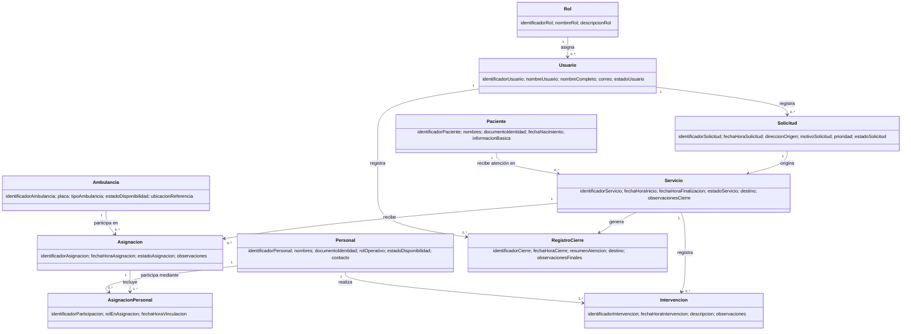

# MD-01 – Modelo de dominio SIGMAVITAL

**Proyecto:** Sistema Gestor de Ambulancias (SGA) – SIGMAVITAL  
**Ficha:** 3413974 – Análisis y Desarrollo de Software (ADSO)  
**Evidencia:** G1-P2 – Modelado y prototipado  
**Versión:** 1.2 – 27/11/2026 · Trazabilidad completa de novedades operativas  
**Estado:** Modelo conceptual de análisis; pendiente de validación con usuarios e instructor.

## 1. Objetivo

Representar los conceptos principales del negocio de gestión de servicios de ambulancia, sus atributos de negocio, asociaciones y multiplicidades. El modelo se mantiene en el nivel conceptual: no incorpora métodos, tipos SQL, índices ni detalles propios de una implementación.

## 2. Alcance

El modelo cubre usuarios y roles, solicitudes, servicios, pacientes, ambulancias, personal operativo, asignaciones, intervenciones, novedades operativas y registros de cierre. Los conceptos se derivan de la línea base de 31 requisitos funcionales de G1-P1. El modelo no representa una historia clínica electrónica integral.

## 3. Convenciones

- **Clase conceptual:** concepto del dominio con identidad y atributos de negocio.
- **Asociación:** relación semántica expresada con un verbo.
- **Mínimo y máximo:** `0..1` significa participación opcional de hasta una instancia; `1..1`, exactamente una; `0..*`, ninguna o varias; `1..*`, una o varias.
- Las multiplicidades se leen desde cada extremo de la asociación y no deben confundirse con la cantidad de tablas.
- No se incluyen operaciones o métodos.

## 4. Clases conceptuales y atributos

### 4.1 Rol

Representa un perfil de autorización del sistema.

| Atributo | Descripción |
|---|---|
| identificadorRol | Identificador del rol |
| nombreRol | Nombre del perfil |
| descripcionRol | Responsabilidades generales del perfil |

### 4.2 Usuario

Representa a una persona autorizada para utilizar SIGMAVITAL.

| Atributo | Descripción |
|---|---|
| identificadorUsuario | Identificador del usuario |
| nombreUsuario | Nombre de acceso |
| nombreCompleto | Nombre de la persona |
| correo | Correo de contacto o acceso |
| estadoUsuario | Estado de la cuenta |

### 4.3 Solicitud

Representa la solicitud de atención que inicia la gestión operativa.

| Atributo | Descripción |
|---|---|
| identificadorSolicitud | Identificador de la solicitud |
| fechaHoraSolicitud | Fecha y hora de registro |
| direccionOrigen | Ubicación donde se requiere el servicio |
| motivoSolicitud | Motivo reportado |
| prioridad | Nivel de prioridad |
| estadoSolicitud | Estado de la solicitud |

### 4.4 Servicio

Representa la atención prehospitalaria asociada a una solicitud.

| Atributo | Descripción |
|---|---|
| identificadorServicio | Identificador del servicio |
| fechaHoraInicio | Fecha y hora de inicio |
| fechaHoraFinalizacion | Fecha y hora de finalización |
| estadoServicio | Estado operativo |
| destino | Destino asistencial o de traslado |
| observacionesCierre | Observaciones de finalización |

### 4.5 Paciente

Representa a la persona atendida, con datos limitados a la finalidad operativa.

| Atributo | Descripción |
|---|---|
| identificadorPaciente | Identificador interno |
| nombres | Nombres disponibles |
| documentoIdentidad | Identificación, cuando esté disponible y autorizada |
| fechaNacimiento | Fecha de nacimiento, cuando sea necesaria |
| informacionBasica | Información mínima pertinente para la atención inicial |

### 4.6 Ambulancia

Representa un vehículo destinado al transporte asistencial.

| Atributo | Descripción |
|---|---|
| identificadorAmbulancia | Identificador interno |
| placa | Placa del vehículo |
| tipoAmbulancia | Tipo o clasificación |
| estadoDisponibilidad | Estado operativo |
| ubicacionReferencia | Ubicación de referencia |

### 4.7 Personal

Representa a los integrantes del equipo operativo.

| Atributo | Descripción |
|---|---|
| identificadorPersonal | Identificador del integrante |
| nombres | Nombre del integrante |
| documentoIdentidad | Identificación de referencia |
| rolOperativo | Función operativa |
| estadoDisponibilidad | Estado de disponibilidad |
| contacto | Medio de contacto autorizado |

### 4.8 Asignacion

Representa la asignación de una ambulancia a un servicio.

| Atributo | Descripción |
|---|---|
| identificadorAsignacion | Identificador de la asignación |
| fechaHoraAsignacion | Fecha y hora de asignación |
| estadoAsignacion | Estado de la asignación |
| observaciones | Observaciones del proceso |

### 4.9 AsignacionPersonal

Representa la participación de un integrante del personal en una asignación. Es una **clase de asociación** entre Asignacion y Personal.

| Atributo | Descripción |
|---|---|
| identificadorParticipacion | Identificador de la participación |
| rolEnAsignacion | Función desempeñada en esa asignación |
| fechaHoraVinculacion | Fecha y hora de vinculación |

### 4.10 Intervencion

Representa una actuación registrada durante la atención del servicio.

| Atributo | Descripción |
|---|---|
| identificadorIntervencion | Identificador de la intervención |
| fechaHoraIntervencion | Fecha y hora de registro |
| descripcion | Descripción de la actuación |
| observaciones | Observaciones relacionadas |

### 4.11 RegistroCierre

Representa el resumen documental del cierre operativo.

| Atributo | Descripción |
|---|---|
| identificadorCierre | Identificador del registro de cierre |
| fechaHoraCierre | Fecha y hora del cierre |
| resumenAtencion | Resumen de la atención |
| destino | Destino asistencial reportado |
| observacionesFinales | Observaciones finales |

### 4.12 NovedadOperativa

Representa un evento o situación relevante que ocurre durante la gestión de un servicio y requiere seguimiento operativo. Se diferencia de `Intervencion`: la intervención documenta una actuación asistencial, mientras que la novedad registra una incidencia, cambio de estado u observación operativa.

| Atributo | Descripción |
|---|---|
| identificadorNovedad | Identificador de la novedad |
| fechaHoraNovedad | Fecha y hora del evento |
| tipoNovedad | Clasificación de la novedad |
| descripcion | Descripción del evento reportado |
| estadoSeguimiento | Estado de atención o seguimiento |
| observaciones | Información complementaria

## 5. Asociaciones, verbos y multiplicidades mínimas/máximas

| Clase origen | Verbo de la asociación | Clase destino | Multiplicidad en origen | Multiplicidad en destino | Interpretación |
|---|---|---|---:|---:|---|
| Rol | asigna | Usuario | 0..* | 1..1 | Un rol puede asignarse a cero o muchos usuarios; cada usuario tiene exactamente un rol en esta versión. |
| Usuario | registra | Solicitud | 0..* | 1..1 | Un usuario puede registrar varias solicitudes; cada solicitud tiene un usuario registrador. |
| Solicitud | origina | Servicio | 0..1 | 1..1 | Una solicitud puede no generar servicio o generar uno; cada servicio procede de una solicitud. |
| Paciente | recibe atención en | Servicio | 0..* | 1..1 | Un paciente puede recibir varios servicios; cada servicio se asocia con un paciente de referencia. |
| Servicio | recibe | Asignacion | 0..* | 1..1 | Un servicio puede tener varias asignaciones históricas; cada asignación pertenece a un servicio. |
| Ambulancia | participa en | Asignacion | 0..* | 1..1 | Una ambulancia puede participar en múltiples asignaciones a lo largo del tiempo; cada asignación identifica una ambulancia. |
| Asignacion | incluye | AsignacionPersonal | 1..* | 1..1 | Cada asignación debe incluir al menos un registro de participación; cada participación corresponde a una asignación. |
| Personal | participa mediante | AsignacionPersonal | 0..* | 1..1 | Una persona puede participar en diferentes asignaciones; cada participación identifica un integrante. |
| Servicio | registra | Intervencion | 0..* | 1..1 | Un servicio puede registrar varias intervenciones; cada intervención pertenece a un servicio. |
| Personal | realiza | Intervencion | 0..* | 1..1 | Un integrante puede realizar varias intervenciones; cada intervención identifica un responsable. |
| Servicio | genera | RegistroCierre | 0..1 | 1..1 | Un servicio puede no tener cierre o tener uno; cada cierre corresponde a un único servicio. |
| Usuario | registra | RegistroCierre | 0..* | 1..1 | Un usuario autorizado puede registrar varios cierres; cada cierre identifica al responsable. |
| Servicio | registra | NovedadOperativa | 0..* | 1..1 | Un servicio puede registrar varias novedades; cada novedad pertenece a un servicio. |
| Usuario | reporta | NovedadOperativa | 0..* | 1..1 | Un usuario con permiso puede reportar varias novedades; cada novedad identifica quién la reportó. |

## 6. Reglas conceptuales

1. Todo usuario debe estar asociado a un rol definido.
2. Una solicitud puede permanecer sin servicio mientras esté pendiente.
3. Un servicio debe originarse en una solicitud registrada.
4. Las asignaciones deben asociarse a un servicio existente y a una ambulancia identificada.
5. Una asignación debe incluir al menos un integrante del personal mediante AsignacionPersonal.
6. Las intervenciones deben estar asociadas a un servicio y a un responsable.
7. El cierre debe estar asociado a un servicio y a un usuario autorizado.
8. Los datos de paciente deben limitarse a los necesarios para la operación y atención inicial.
9. Los estados de solicitud, asignación y servicio deben mantener consistencia durante el ciclo operativo.
10. Las novedades operativas se registran como concepto independiente y no se confunden con las intervenciones asistenciales.
11. Las cardinalidades representan la regla conceptual propuesta y deben confirmarse con el responsable del proceso antes de la implementación.

## 7. Diagrama conceptual de dominio

## 8. Clase de asociación

`AsignacionPersonal` es una clase de asociación porque describe el vínculo entre una Asignacion y una Persona concreta e incorpora atributos propios de esa participación (`rolEnAsignacion` y `fechaHoraVinculacion`). No se fuerza una jerarquía de generalización: las clases del dominio no representan especializaciones «es-un» que sean necesarias para estos procesos.

## 9. Verificación del modelo

| Criterio | Resultado | Evidencia |
|---|---|---|
| Ocho o más clases conceptuales | Cumple | Se identifican doce clases en la sección 4. |
| Dos o más atributos de negocio en al menos cinco clases | Cumple | Tablas de atributos de las secciones 4.1 a 4.11. |
| Asociaciones con verbos y multiplicidades | Cumple documentalmente | Tabla de la sección 5 y diagrama. |
| Clase de asociación o generalización justificada | Cumple | AsignacionPersonal; sección 8. |
| Sin métodos ni detalles físicos SQL | Cumple | Diagrama conceptual. |
| Coherencia con CU-08, CU-11 y CU-22 | Cumple a nivel de diseño | Matriz P2 y casos de uso extendidos. |
| Validación con usuarios/instructor | Pendiente | No se adjunta acta de validación externa. |

## 10. Trazabilidad y limitaciones

El modelo ofrece una base conceptual para los doce conceptos ROL, USUARIO, SOLICITUD, SERVICIO, PACIENTE, AMBULANCIA, PERSONAL, ASIGNACION, ASIGNACION_PERSONAL, INTERVENCION, REGISTRO_CIERRE y NOVEDAD_OPERATIVA. RF-21 se vincula directamente con NovedadOperativa y Servicio. La separación evita equiparar una novedad operativa con una intervención asistencial.

La presencia de una clase en el modelo no acredita implementación ni validación con usuarios. Las cardinalidades son propuestas de análisis y requieren confirmación con el contexto operativo.

---

**SENA – ADSO – Ficha 3413974**
