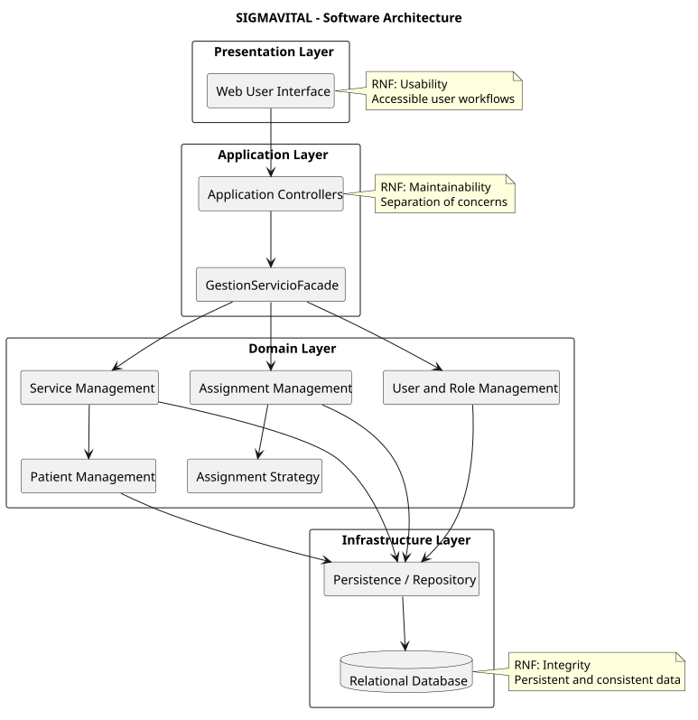

# A4 – Arquitectura de Software y Decisiones de Diseño – SIGMAVITAL

**Diagrama editable (.drawio):** [A4-Arquitectura-SIGMAVITAL.drawio](A4-Arquitectura-SIGMAVITAL.drawio)  
**Vector SVG (.svg):** [A4-Arquitectura-SIGMAVITAL.svg](A4-Arquitectura-SIGMAVITAL.svg)

## 1. Estilo arquitectónico en 4 capas estrictas

Se adopta una **arquitectura monolítica modular en 4 capas estrictas** sobre **PHP 8.3 / Laravel 11 + React 18 SPA + MySQL 8/InnoDB**:

1. **Capa de Presentación:** SPA React responsiva (`RNF-017`) y canal WebSocket para tablero operativo en tiempo real (`RF-028`). Se comunica **únicamente** con la Capa de Aplicación por HTTPS/WSS (`443`); queda prohibido acceso directo desde UI hacia base de datos.
2. **Capa de Aplicación:** controladores REST Laravel, autenticación JWT con expiración <= 8 h e inactividad de 15 min (`RF-002/003`), RBAC (`RF-005`), `GestionServicioFacade` y workers asíncronos de alertas y exportación PDF/Excel.
3. **Capa de Dominio:** entidades de negocio puras, validadores de reglas `RN-001..RN-018`, `EstrategiaAsignacion` (despacho <= 2 s) e inmutabilidad contable/auditoría.
4. **Capa de Infraestructura:** implementación de `IRepositorioDatos` vía PDO/MySQL 8 en subred privada (`TCP 3306`), repositorio documental con hash SHA-256 y servicio SMTP (`TLS 587`).

## 2. Matriz de decisiones vinculadas a RNF (6 RNF críticos)

| Requisito RNF | Decisión arquitectónica adoptada | Alternativa descartada y motivo |
|---|---|---|
| `RNF-001 / RNF-002 / RNF-006` | TLS 1.3 obligatorio en Nginx, JWT firmado, hashing Argon2id/bcrypt y validación Request Laravel contra SQLi/XSS/CSRF | Autenticación básica sin token o consultas SQL concatenadas manualmente (riesgo OWASP). |
| `RNF-008 / RNF-009` | Índices compuestos MySQL + `EstrategiaAsignacion` en memoria PHP resuelta en `<= 2 s` | Consultas pesadas multi-servicio por HTTP entre microservicios (latencia de red innecesaria). |
| `RNF-013 / RNF-015` | Contenedores Docker con política de reinicio automático, logs centralizados y respaldos diarios verificados | Ejecución sin aislamiento ni monitoreo de salud de proceso. |
| `RNF-022` | Desacoplamiento en contenedores Docker stateless para escalar réplicas HTTP tras balanceador | Estado de sesión guardado en archivos locales del servidor único. |
| `RNF-025 / RNF-027` | Separación estricta mediante interfaces `I*` en componentes y `IRepositorioDatos` para conectar futuros módulos (GPS / HCE) | Lógica de negocio incrustada dentro de vistas React o disparadores ocultos imposibles de probar. |

## 3. Protocolos de comunicación entre capas

- **Presentación -> Aplicación:** HTTPS REST JSON + WSS en puerto `443` con encabezado Bearer JWT.
- **Aplicación -> Dominio:** llamadas síncronas en memoria mediante interfaces PHP tipadas y DTOs validados.
- **Dominio -> Infraestructura:** inversión de dependencias a través de `IRepositorioDatos`; conexiones SQL por `TCP 3306` cifradas en red privada y envío de correos por `SMTP STARTTLS 587`.

