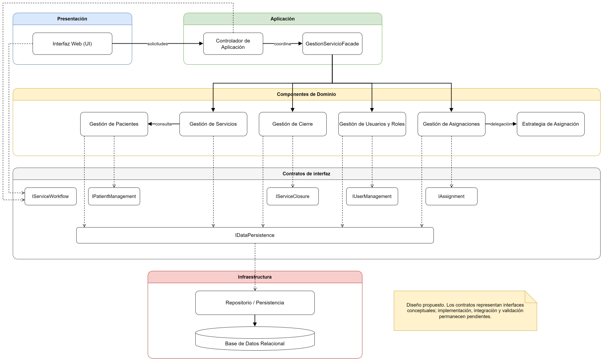

# A5 – Vista de Componentes y Contratos de Interfaz – SIGMAVITAL

**Diagrama editable (.drawio):** [A5-Component-View-SIGMAVITAL.drawio](A5-Component-View-SIGMAVITAL.drawio)  
**Vector SVG (.svg):** [A5-Component-View-SIGMAVITAL.svg](A5-Component-View-SIGMAVITAL.svg)

## 1. Descomposición modular y contratos (100 % del SRS)

| Componente | Interfaz provista | Interfaces requeridas | Módulos y RF atendidos |
|---|---|---|---|
| **Frontend SPA React + Echo WS** | `IInterfazOperativaUI` | `IAutenticacionRBAC`, `IDespachoEmergencias` | Tablero tiempo real, `P-01..P-03`, vistas administrativas (`RF-028/029`) |
| **Seguridad, Usuarios y RBAC** | `IAutenticacionRBAC` | `IRepositorioDatos`, `IAuditoriaInmutable` | Registro/ciclo de usuarios, JWT <= 8 h, bloqueo 5 intentos (`RF-001..007`) |
| **Emergencias, Pacientes y Monitoreo** | `IDespachoEmergencias` | `IGestionFlotaTalento`, `IFacturacionInmutable`, `IGestionInstitucional` | Solicitudes, triage, `EstrategiaAsignacion`, cierre `RN-005` (`RF-018..029`) |
| **Flota, Propietarios y Personal** | `IGestionFlotaTalento` | `IRepositorioDatos`, `IAuditoriaInmutable` | Inventario TAB/TAM, SOAT/REPS, propietarios, personal (`RF-008..017`, `RF-045..046`) |
| **Financiero y Proveedores** | `IFacturacionInmutable` | `IRepositorioDatos`, `IAuditoriaInmutable` | Facturas al cierre `RN-014`, notas, cartera/mora y contratos (`RF-030..035`, `047..049`) |
| **Visitantes, PQRS, Docs y Novedades** | `IGestionInstitucional` | `IAuditoriaInmutable`, `IRepositorioDatos`, `IGeneradorReportes` | Preautorizaciones, PQRS 24 h, repositorio SHA-256 y novedades (`RF-036..044`, `050..054`, `059..063`) |
| **Reportes Operativos e Indicadores KPI** | `IGeneradorReportes` | `IRepositorioDatos` | Reportes programados PDF/Excel read-only y KPIs (`RF-064..065`) |
| **Motor Transversal de Auditoría Inmutable** | `IAuditoriaInmutable` | `IRepositorioDatos` | Bitácora append-only 5 años y alertas críticas (`RF-055..058`, `RN-010`) |
| **Capa de Persistencia MySQL 8 / InnoDB** | `IRepositorioDatos` | Ninguna | Ejecución transaccional PDO sobre esquema 3FN de 25 tablas |

