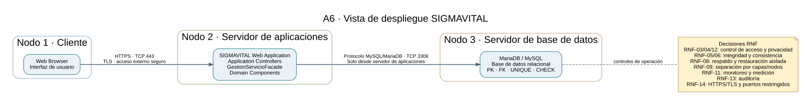

# A6 – Arquitectura de Despliegue y Topología de Nodos – SIGMAVITAL

**Diagrama editable (.drawio):** [A6-Deployment-View-SIGMAVITAL.drawio](A6-Deployment-View-SIGMAVITAL.drawio)  
**Vector SVG (.svg):** [A6-Deployment-View-SIGMAVITAL.svg](A6-Deployment-View-SIGMAVITAL.svg)

## 1. Nodos de ejecución y enlaces de red

| Nodo | Contenedores / Componentes alojados | Protocolo y puerto | Requisitos RNF asociados |
|---|---|---|---|
| **Nodo 1 · Cliente Web y Tableta** | Navegadores compatibles (Chrome/Edge/Firefox/Safari) ejecutando SPA React | `HTTPS / WSS (TCP 443)` hacia Nginx | `RNF-002`, `RNF-017`, `RNF-023` |
| **Nodo 2 · Servidor Aplicación Docker** | Proxy Nginx TLS 1.3, API Laravel 11, WebSockets, Workers de alertas/PDF | `TCP 3306` interno a BD; `SMTP 587` a alertas | `RNF-008`, `RNF-009`, `RNF-013`, `RNF-022` |
| **Nodo 3 · Servidor Base de Datos** | Motor MySQL 8.0 / MariaDB InnoDB (25 tablas, cifrado en reposo Ley 1581) | Solo red privada (`TCP 3306` restringido al Nodo 2) | `RNF-004`, `RNF-021` |
| **Nodo 4 · Almacenamiento Externo y SMTP** | Bóveda externa de respaldos diarios cifrados (30 copias) y documentos SHA-256 | `SFTP / HTTPS cifrado`, `SMTP STARTTLS 587` | `RNF-015`, `RNF-029` (`RTO <= 4 h`, `RPO <= 24 h`) |

