# B1 – Modelo Conceptual de Datos – SIGMAVITAL (SGA)

**Diagrama editable (.drawio):** [B1-Diagrama-Conceptual.drawio](B1-Diagrama-Conceptual.drawio)  
**Vector SVG (.svg):** [B1-Diagrama-Conceptual.svg](B1-Diagrama-Conceptual.svg)

## 1. Propósito y alcance conceptual

Define las **24 entidades conceptuales de negocio** necesarias para soportar el 100 % de los módulos del SRS (`RF-001` a `RF-065`) y reglas (`RN-001` a `RN-018`), previo a su transformación física a tablas normalizadas en `B2` y MySQL en `B5`.

## 2. Participaciones y cardinalidades verificadas (Origen -> Destino)

| Entidad origen | Card. origen | Part. origen | Verbo | Part. destino | Card. destino | Entidad destino |
|---|---:|---|---|---|---:|---|
| `Rol` | `1` | Obligatoria | agrupa | Opcional | `0..*` | `Usuario` |
| `Usuario` | `1` | Obligatoria | registra | Opcional | `0..*` | `Solicitud` |
| `PropietarioUnidad` | `1` | Obligatoria | posee | Opcional | `0..*` | `Ambulancia` |
| `Ambulancia` | `1` | Obligatoria | recibe | Opcional | `0..*` | `MantenimientoUnidad` |
| `Ambulancia` | `1` | Obligatoria | cubre | Opcional | `0..*` | `Asignacion` |
| `Solicitud` | `1` | Obligatoria | origina | Opcional | `0..1` | `Servicio` |
| `Paciente` | `1` | Obligatoria | recibe atención | Opcional | `0..*` | `Servicio` |
| `Servicio` | `1` | Obligatoria | registra | Obligatoria | `1..*` | `HistorialEstadoServicio` **(Débil)** |
| `Servicio` | `1` | Obligatoria | requiere | Opcional | `0..*` | `Asignacion` |
| `Asignacion` | `0..*` | Opcional | vincula | Obligatoria | `1..*` | `Personal` *(vía N:M `AsignacionPersonal`)* |
| `Servicio` | `1` | Obligatoria | consolida | Opcional | `0..1` | `RegistroCierre` |
| `Servicio` | `1` | Obligatoria | origina factura | Opcional | `0..1` | `Factura` |
| `Factura` | `1` | Obligatoria | ajusta con | Opcional | `0..*` | `NotaContable` |
| `Proveedor` | `1` | Obligatoria | suscribe | Opcional | `0..*` | `ContratoProveedor` |

## 3. Vista del diagrama conceptual B1

