# B2 – Modelo Relacional Normalizado (3FN) y Reglas de Transformación – SIGMAVITAL

**Diagrama editable (.drawio):** [B2-Diagrama-Relacional.drawio](B2-Diagrama-Relacional.drawio)  
**Vector SVG (.svg):** [B2-Diagrama-Relacional.svg](B2-Diagrama-Relacional.svg)

## 1. Cuadro de reglas de transformación Conceptual (B1) -> Relacional (B2)

| Regla aplicada | Patrón en modelo conceptual B1 | Transformación al esquema relacional B2 | Ejemplos aplicados en SIGMAVITAL |
|---|---|---|---|
| **R1 · Entidad fuerte** | Entidad independiente con identificador único | Tabla homónima con `PK INT AUTO_INCREMENT` y `UNIQUE` en claves candidatas | `Rol`, `Usuario`, `Paciente`, `Servicio`, `Ambulancia`, `Proveedor`, `Documento` |
| **R2 · Relación `1 : N`** | Un registro padre asociado a cero o muchos hijos | La clave primaria del lado `1` pasa como `FK` en la tabla del lado `N` | `Rol.id_rol -> Usuario`, `PropietarioUnidad.id_propietario -> Ambulancia`, `Factura.id_factura -> NotaContable` |
| **R3 · Relación `1 : 0..1`** | Dependencia única opcional u obligatoria al cierre | Clave foránea `FK` con restricción `UNIQUE` en la tabla subordinada | `Servicio.id_solicitud (UK)`, `RegistroCierre.id_servicio (UK)`, `Factura.id_servicio (UK)` |
| **R4 · Relación `N : M`** | Asociación muchos a muchos con atributos de vinculación | Creación de tabla intermedia con `FK` a ambos extremos y `UNIQUE` compuesto | `AsignacionPersonal` (`id_asignacion`, `id_personal`, `UNIQUE(id_asignacion, id_personal)`) |
| **R5 · Entidad débil** | Existencia dependiente sin llave propia autónoma | Tabla con `PK compuesta` integrando la `FK` del padre + discriminador `secuencia` y `ON DELETE CASCADE` | `HistorialEstadoServicio (PK(id_servicio, secuencia))` |
| **R6 · Atributo multivaluado (1FN)** | Conjunto múltiple de valores por fila (`{telefonos}`) | Extracción a tabla hija normalizada `1:N` | `PacienteTelefono (id_telefono, FK id_paciente, telefono)` |
| **R7 · Generalización / Especialización** | Subtipos `TAB` y `TAM` sobre `Ambulancia` | Tabla única con discriminador `tipo CHECK (tipo IN ('TAB','TAM'))` evitando joins dispersos y duplicación de placa/REPS | `Ambulancia` con `dotacion_reps_valida` y validaciones `REPS` |

## 2. Resumen de tablas normalizadas (25 tablas)

Todas las tablas conservan nombres `PascalCase` y columnas `snake_case` en **MySQL 8.0 / InnoDB**, garantizando 100 % de paridad entre `B2`, `B4` y `B5`.

