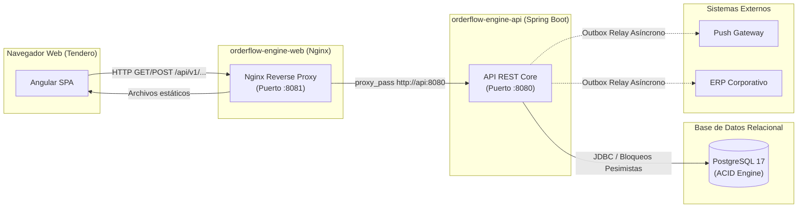
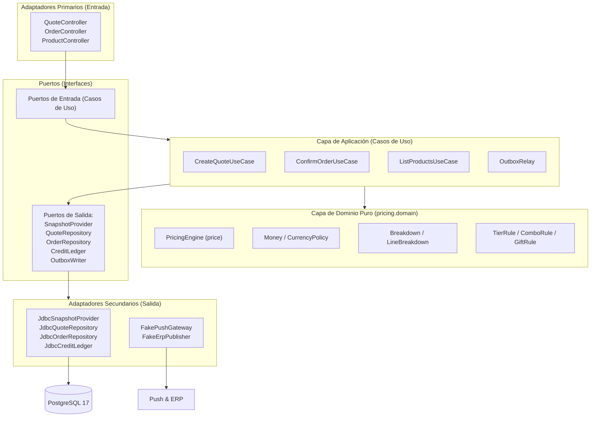
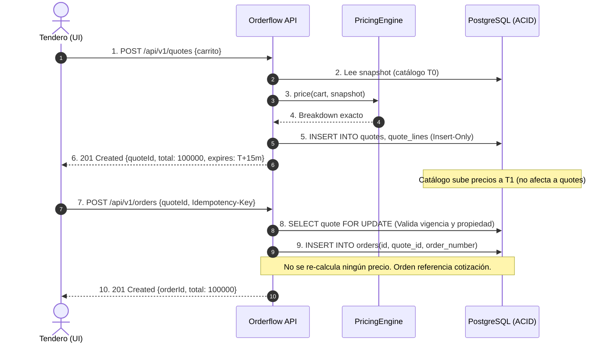
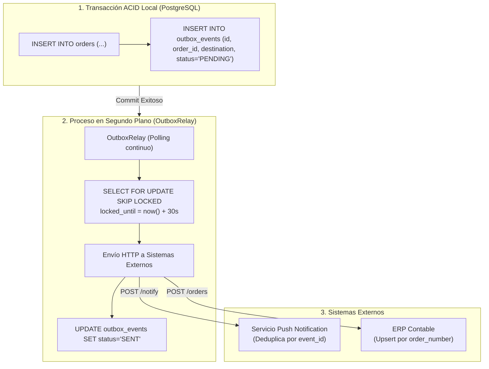
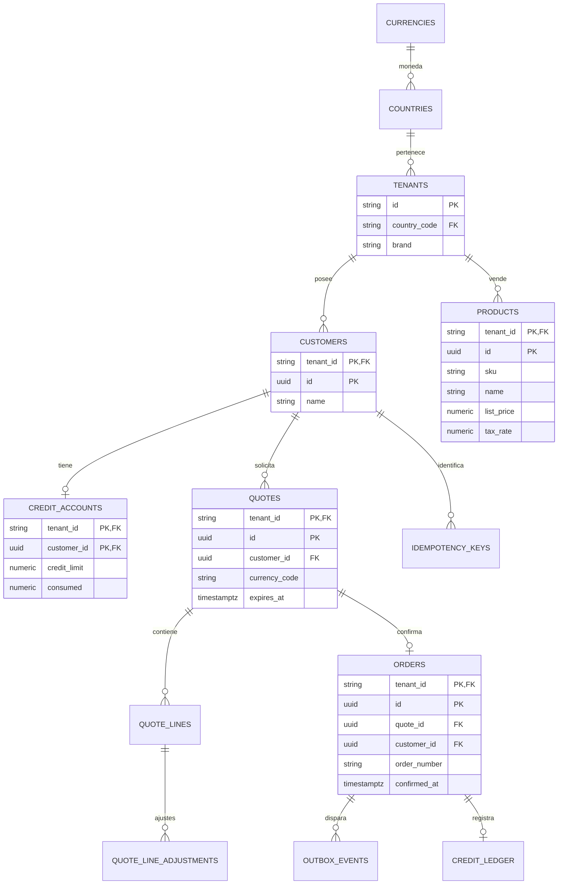
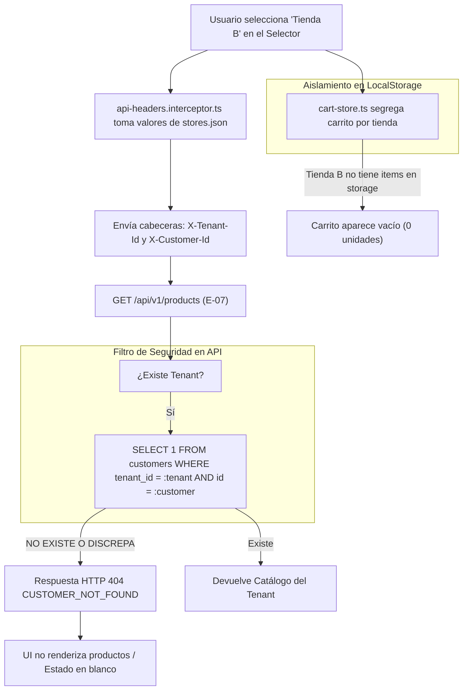
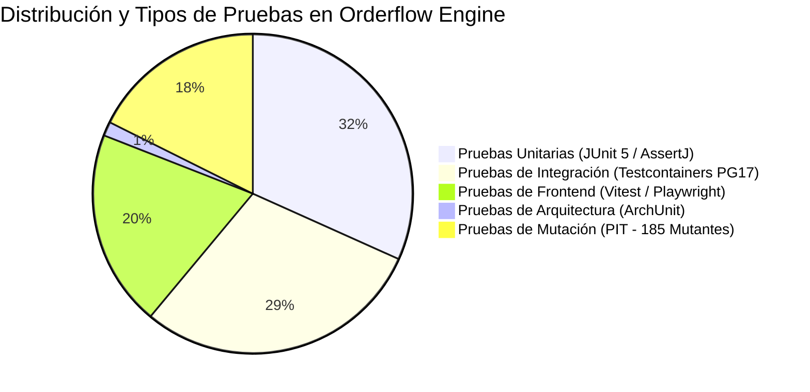
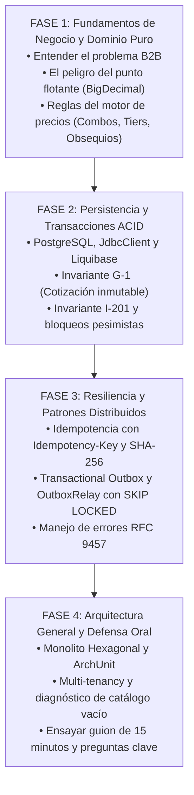

# GUÍA TÉCNICA DE ESTUDIO Y EXPOSICIÓN — ORDERFLOW ENGINE
### Versión basada en el sitio público y los repositorios enlazados
### Arquitectura, Dominio B2B, Transaccionalidad ACID y Motor de Precios


> **Fuente principal de esta versión:** [sitio público de Orderflow Engine](https://ariel5253.github.io/orderflow-engine-page/), consultado el 17 de octubre de 2026, más los repositorios públicos que el sitio enlaza, en particular el [API](https://github.com/ariel5253/orderflow-engine-api) y la [infraestructura](https://github.com/ariel5253/orderflow-engine-infra). Se contrastó el texto visible de la página con documentación de ejecución y contrato de API publicada en GitHub. Algunos textos de la landing se construyen con JavaScript y no todos los bloques son legibles en una extracción de texto; por eso esta guía se apoya en lo observable y lo contrasta con los README accesibles.
>
> **Estado de verificación:** los repositorios API e infraestructura son visibles públicamente en GitHub. Esta sesión no clonó los repositorios ni ejecutó sus comandos; las pruebas y métricas que se citan como resultados de `HANDOFF.md` o README son **resultados registrados por el proyecto**, no nuevas ejecuciones realizadas durante esta preparación.
>
> **Punto actualizado sobre el catálogo vacío:** la documentación de tareas registra T-19 para nombres semilla y configuración web en español y T-20 para Guatemala y Perú. Por tanto, no debe afirmarse como causa actual que falte una tienda ecuatoriana sin comparar los IDs de `stores.json`, las cabeceras efectivas `X-Tenant-Id`/`X-Customer-Id` y los seeds/migraciones del entorno inspeccionado.
>
> **Etiquetas de certeza:** `[Documentado]` corresponde a documentación del proyecto; `[Visible en la página]` corresponde a contenido observable en el sitio publicado; `[Registrado por el proyecto]` corresponde a salidas consignadas en README/HANDOFF; `[No ejecutado aquí]` indica que no se corrió de nuevo la aplicación en esta preparación.

---

## ÍNDICE GENERAL

1. [Portada e Identificación](#1-portada-e-identificación)
2. [Resumen Ejecutivo](#2-resumen-ejecutivo)
3. [Contexto del Negocio B2B](#3-contexto-del-negocio-b2b)
4. [Requisitos Funcionales y No Funcionales](#4-requisitos-funcionales-y-no-funcionales)
5. [Arquitectura General del Sistema](#5-arquitectura-general-del-sistema)
6. [Arquitectura Hexagonal (Puertos y Adaptadores)](#6-arquitectura-hexagonal-puertos-y-adaptadores)
7. [Domain-Driven Design (DDD)](#7-domain-driven-design-ddd)
8. [Motor de Precios y Reglas Comerciales](#8-motor-de-precios-y-reglas-comerciales)
9. [Dinero Exacto y Precisión Decimal](#9-dinero-exacto-y-precisión-decimal)
10. [Cotizaciones Inmutables (Invariante G-1)](#10-cotizaciones-inmutables-invariante-g-1)
11. [Transacciones y Principios ACID](#11-transacciones-y-principios-acid)
12. [Idempotencia Transaccional](#12-idempotencia-transaccional)
13. [Concurrencia y Bloqueos Pesimistas](#13-concurrencia-y-bloqueos-pesimistas)
14. [Patrón Transactional Outbox](#14-patrón-transactional-outbox)
15. [Modelo de Datos y Persistencia Relacional](#15-modelo-de-datos-y-persistencia-relacional)
16. [Multi-Tenancy y Diagnóstico del Catálogo Vacío](#16-multi-tenancy-y-diagnóstico-del-catálogo-vacío)
17. [API REST y Manejo Estandarizado de Errores](#17-api-rest-y-manejo-estandarizado-de-errores)
18. [Frontend Web Angular y Prevención de Defectos](#18-frontend-web-angular-y-prevención-de-defectos)
19. [Infraestructura, Contenedores y Ejecución](#19-infraestructura-contenedores-y-ejecución)
20. [Seguridad, Aislamiento y Defensa en Profundidad](#20-seguridad-aislamiento-y-defensa-en-profundidad)
21. [Estrategia de Pruebas y Calidad de Software](#21-estrategia-de-pruebas-y-calidad-de-software)
22. [Decisiones Arquitectónicas y Registro ADR](#22-decisiones-arquitectónicas-y-registro-adr)
23. [Inventario Tecnológico Completo](#23-inventario-tecnológico-completo)
24. [Riesgos Técnicos, Limitaciones y Cuestiones Pendientes](#24-riesgos-técnicos-limitaciones-y-cuestiones-pendientes)
25. [Guion Metodológico de Exposición Oral (15 Minutos)](#25-guion-metodológico-de-exposición-oral-15-minutos)
26. [Banco de Preguntas de Evaluadores y Respuestas Explicadas](#26-banco-de-preguntas-de-evaluadores-y-respuestas-explicadas)
27. [Glosario Técnico de Términos](#27-glosario-técnico-de-términos)
28. [Plan de Estudio Progresivo (Ruta de Aprendizaje ADSO)](#28-plan-de-estudio-progresivo-ruta-de-aprendizaje-adso)
29. [Lista de Comprobación Previa a la Exposición](#29-lista-de-comprobación-previa-a-la-exposición)
30. [Fuentes Documentales y Trazabilidad](#30-fuentes-documentales-y-trazabilidad)

---

## 1. PORTADA E IDENTIFICACIÓN

* **Nombre del Proyecto:** Orderflow Engine
* **Título del Documento:** Guía Integral de Estudio, Comprensión y Defensa Técnica de Arquitectura
* **Perfil de Destino:** Estudiantes de Análisis y Desarrollo de Software (ADSO) y Desarrolladores Backend / Fullstack en preparación para evaluación técnica ante Tech Leads y Arquitectos de Software.
* **Fecha de Elaboración:** Octubre de 2026.
* **Propósito del Documento:** Servir como instrumento maestro de estudio teórico-práctico y defensa técnica para dominar los fundamentos de arquitectura de software, concurrencia, transaccionalidad, modelado de dominio puro, precisión numérica en dinero y patrones de resiliencia implementados en el proyecto Orderflow Engine.
* **Criterio de Fidelidad y Fuentes Consultadas:**
  1. Enunciado original de la prueba técnica: [`assignment/Prueba_Tecnica_Tech_Lead_1.pdf`](assignment/Prueba_Tecnica_Tech_Lead_1.pdf).
  2. Documentación viva de arquitectura y especificación: [`spec/SPEC.md`](spec/SPEC.md), [`spec/architecture.md`](spec/architecture.md), [`spec/data-model.md`](spec/data-model.md), [`spec/api-contract.md`](spec/api-contract.md), [`spec/constitution.md`](spec/constitution.md), [`spec/plan.md`](spec/plan.md) y [`spec/TASKS.md`](spec/TASKS.md).
  3. Registro de decisiones arquitectónicas formal: [`deliverables/adr/0001-order-pricing-and-confirmation.es.pdf`](deliverables/adr/0001-order-pricing-and-confirmation.es.pdf).
  4. Estado de entrega e informe de handoff: [`handoff/HANDOFF.md`](handoff/HANDOFF.md).
* **Convención de Certeza y Evidencia en esta Guía:**
  - **[Documentado]:** Concepto, clase, regla o decisión registrada formalmente en la documentación viva del proyecto.
  - **[Verificado]:** Comprobado directamente en archivos locales accesibles o validaciones ejecutadas.
  - **[Interpretación Técnica]:** Explicación didáctica y deducción arquitectónica fundamentada en principios de ingeniería de software.
  - **[Pendiente de Verificar en Código]:** Aspecto descrito en documentación o repositorios públicos, pero cuyo comportamiento no se volvió a ejecutar en esta preparación (`orderflow-engine-api`, `orderflow-engine-web`, etc.).

---

## 2. RESUMEN EJECUTIVO

**Orderflow Engine** es el motor central de cálculo de precios y confirmación transaccional de pedidos para una plataforma de comercio electrónico mayorista B2B (*Business-to-Business*) de distribución masiva de bebidas. El sistema opera de manera **multi-tenant** (múltiples marcas y países compartiendo la misma infraestructura) en Colombia, Ecuador, Guatemala y Perú.

### El Problema Comercial
En el negocio de consumo masivo, los distribuidores de bebidas abastecen a decenas de miles de pequeños comerciantes (tiendas de barrio, bodegas, minimarkets). Las negociaciones comerciales no son a precio fijo: intervienen complejas **palancas comerciales** simultáneas (descuentos marginales por volumen, paquetes en combo y obsequios con implicaciones tributarias), compras a crédito con cupo restringido y legislaciones tributarias y monetarias diversas según el país (COP sin decimales, USD/GTQ/PEN con dos decimales).

### Los Retos Técnicos Críticos
El sistema fue diseñado para resolver y erradicar tres grandes patologías reportadas en sistemas heredados:
1. **Divergencia entre Cotización y Facturación:** Ocurría cuando un tendero cotizaba a un precio y, debido a un cambio en el catálogo durante su navegación, la confirmación final le cobraba un importe diferente.
2. **El Defecto del "201 Fantasma" (Confirmado pero Inexistente):** En tres versiones anteriores del sistema heredado, el servidor respondía HTTP 201 Created otorgando un número de orden al tendero, pero posteriormente el pedido no existía en la base de datos ni aparecía en su historial de compras.
3. **Pérdida o Duplicidad de Eventos en Integraciones:** Pedidos confirmados que no llegaban al ERP contable o a la pasarela de notificaciones Push, o que se duplicaban ante micro-cortes de red y reintentos del cliente (*doble tap*).

### Síntesis de las Soluciones Arquitectónicas Elegidas
* **Monolito Hexagonal Modular con Dominio Puro:** La lógica de cálculo no depende de ningún framework ni base de datos, implementada en Java 21 con `BigDecimal` y protegida contra punto flotante mediante reglas ArchUnit.
* **Cotizaciones Selladas de Solo Inserción (Invariante G-1):** Una cotización se congela en base de datos. La orden de compra posterior referencia a la cotización sin almacenar importes duplicados, garantizando consistencia por construcción.
* **Confirmación Atómica e Idempotente en PostgreSQL (Invariante G-3 e I-201):** Adquisición estricta y ordenada de bloqueos pesimistas de fila (`idempotency_keys` $\to$ `quotes` $\to$ `credit_accounts`). La respuesta HTTP 201 se emite **únicamente después del COMMIT** exitoso de la transacción.
* **Patrón Transactional Outbox (Invariante G-4):** Los eventos para ERP y Push se insertan en la misma transacción ACID de la orden en la tabla `outbox_events` y un despachador en segundo plano (*relay*) los distribuye de forma asíncrona garantizando entrega *al menos una vez* (*at-least-once*).

---

## 3. CONTEXTO DEL NEGOCIO B2B

### 3.1. ¿Qué es un modelo B2B frente a un B2C?
* **B2C (*Business to Consumer*):** Venta directa al consumidor final (ej. un usuario comprando un refresco en un supermercado). Los precios suelen ser fijos, se paga de inmediato con tarjeta o efectivo y los volúmenes son unitarios.
* **B2B (*Business to Drinkers / Business to Business*):** Venta entre empresas. En Orderflow Engine, el **comprador** es el *tendero* (dueño de la tienda de barrio) y el **vendedor** es el *distribuidor mayorista de bebidas*.

### 3.2. Características Clave del Flujo B2B en este Dominio
1. **Volumen y Escalas:** Un tendero no compra una botella; compra petacos, cajas o pacas. A mayor volumen adquirido, el distribuidor otorga mejores tarifas mediante **escalas marginales por tramos**.
2. **Líneas de Crédito:** Muchos tenderos operan bajo modalidad de crédito rotativo: reciben la mercancía a inicio de semana, venden los productos y pagan al distribuidor días después. El sistema debe validar que el pedido "quepa" en su cupo disponible.
3. **Multi-País y Fiscalidad Heterogénea:**
   - **Colombia (COP):** Moneda de valor nominal alto, escala decimal 0 (no existen centavos en transacciones reales), obsequios gravados con IVA sobre su valor de referencia.
   - **Ecuador (USD):** Economía dolarizada, escala decimal 2, obsequios exentos de impuesto comercial en el modelo sembrado.
   - **Guatemala (GTQ) y Perú (PEN):** Monedas con escala decimal 2 y tasas impositivas propias (12% y 18% respectivamente).

### 3.3. Ciclo de Vida del Pedido en Orderflow Engine
```
[Catálogo] ──> [Carrito] ──> [Checkout / Cotización] ──> [Confirmación] ──> [Historial / ERP]
```
* **Catálogo:** Lista de productos disponibles para el tenant al que pertenece el cliente.
* **Carrito:** Selección temporal de `{sku, cantidad}` en el navegador del usuario.
* **Checkout (Cotización - E-01):** Evaluación de todas las reglas comerciales. Produce un desglose exacto con tiempo de expiración (TTL de 15 minutos).
* **Confirmación (E-03):** Operación transaccional donde el tendero acepta la cotización, se descuenta su cupo de crédito y se genera la orden en firme.
* **Historial (E-05):** Consulta en tiempo real de los pedidos confirmados por el tendero.

---

## 4. REQUISITOS FUNCIONALES Y NO FUNCIONALES

La prueba técnica original ([`Prueba_Tecnica_Tech_Lead_1.pdf`](assignment/Prueba_Tecnica_Tech_Lead_1.pdf)) estructura las exigencias en tres partes maestras:

### 4.1. Requisitos de la Parte A1 — Motor de Cálculo (Pricing Engine)
* **REQ-A1-1 [Funcional]: Desglose Completo.** Endpoint o caso de uso que reciba el carrito y devuelva el desglose detallado: subtotal bruto, descuentos aplicados con origen, obsequios con cantidad, base gravable, impuestos y total a pagar.
* **REQ-A1-2 [Funcional]: Coexistencia y Orden de Palancas.** Las palancas deben coexistir en el mismo pedido. Se exige definir y documentar el orden de aplicación y justificar por qué ese orden es el correcto.
* **REQ-A1-3 [Funcional]: Cupo de Crédito.** Si el cliente paga a crédito, el cálculo debe indicar si el pedido cabe en el cupo disponible (`fits`, `available`, `shortfall`).
* **REQ-A1-4 [No Funcional]: Invariante Cotizado = Confirmado.** El total cotizado y el total confirmado deben ser **idénticos**. El diseño debe impedir que diverjan aunque los precios del catálogo cambien en el intermedio.
* **REQ-A1-5 [No Funcional]: Cero Punto Flotante.** Prohibido el uso de aritmética de punto flotante binario (`float`, `double`) para dinero. Especificar tipo, escala, redondeo y puntos exactos de aplicación.
* **REQ-A1-6 [No Funcional]: Multi-país.** Moneda, escala decimal y tasas no pueden estar quemadas (*hard-coded*) en el código.

### 4.2. Requisitos de la Parte A2 — Confirmación de Pedido: Idempotencia y Consistencia
* **REQ-A2-1 [No Funcional]: Idempotencia Estricta.** `POST /orders` debe aceptar una cabecera `Idempotency-Key`. Reintentos de red, doble tap o reintentos automáticos no pueden crear pedidos duplicados ni consumir el cupo dos veces.
* **REQ-A2-2 [No Funcional]: Invariante del 201 (I-201).** Si la respuesta HTTP es 201 con número de orden, la orden **existe y es consultable de inmediato**. Se debe definir el mecanismo que erradique el bug heredado de pedidos desaparecidos.
* **REQ-A2-3 [No Funcional]: Efectos hacia Afuera (Outbox).** Disparo atómico de notificación Push y publicación al ERP. Garantizar que no se pierdan ni dupliquen ante caídas del sistema externo.
* **REQ-A2-4 [No Funcional]: Modelo de Consistencia.** Documentar formalmente el modelo elegido y qué compromisos (*trade-offs*) se asumen.

### 4.3. Requisitos de la Parte A3 — ADR (Architecture Decision Record)
* **REQ-A3 [Documental]: ADR en Máximo 1 Página.** Debe registrar: decisiones tomadas y alternativas descartadas, qué no se implementó conscientemente, qué se buscaría en un code review y un riesgo identificado con su mitigación.

### 4.4. Cobertura de Pruebas Obligatoria: Los 6 Golden Tests
El enunciado fijó seis escenarios mínimos (*Golden Tests*) indispensables:
1. **GT-01:** Pedido con descuento en dos tramos.
2. **GT-02:** Combo donde los productos que lo integran no aparecen como descuento suelto.
3. **GT-03:** Pedido con obsequio con su cantidad en el desglose.
4. **GT-04:** Combo con impuestos, verificando que el impuesto entra en el total.
5. **GT-05:** Pedido a crédito que excede el cupo disponible.
6. **GT-06:** Regresión de cotización: cotizar, cambiar catálogo/palancas, confirmar; el total confirmado es idéntico al cotizado.

---

## 5. ARQUITECTURA GENERAL DEL SISTEMA

### 5.1. Topología de Ejecución y Frontera de Red
El sistema está diseñado para operar bajo un esquema de **mismo origen (*Single Origin*)**, mitigando por completo la necesidad de configurar CORS (*Cross-Origin Resource Sharing*) en la API backend.



### 5.2. Componentes y Responsabilidades
1. **`orderflow-engine-web` (Angular + Nginx):**
   - Sirve la interfaz gráfica SPA compilada.
   - Nginx actúa como reverse proxy: las llamadas a `/api/` se reenvían internamente al contenedor de la API (`http://api:8080`), permitiendo que el navegador vea una sola URL de origen.
   - No realiza cálculos de dinero ni almacena importes; solo formatea y muestra lo que envía la API.
2. **`orderflow-engine-api` (Spring Boot + Java 21):**
   - Núcleo transaccional y de cálculo.
   - Expone endpoints REST bajo `/api/v1/`.
   - Aloja el motor de precios puro y ejecuta las transacciones de confirmación.
3. **`PostgreSQL 17`:**
   - Única fuente de la verdad (*Single Source of Truth*).
   - Garantiza aislamiento transaccional READ COMMITTED con bloqueos pesimistas explícitos.
4. **`Outbox Relay`:**
   - Hilo/demonio en segundo plano que lee eventos encolados en la base de datos y los envía a Push y ERP con políticas de reintento exponencial y *lease*.

### 5.3. ¿Por qué Monolito Modular frente a Microservicios? [Documentado en DEC-03]
* **Microservicios (Descartado):** Si se hubiesen separado `quotes`, `orders`, `credit` y `outbox` en servicios independientes con bases de datos distribuidas, la confirmación de una orden habría requerido un protocolo de dos fases (2PC) o un patrón Saga. Si el servicio de crédito falla a mitad de la saga, el sistema queda en estado inconsistente o requiere compensaciones complejas.
* **Monolito Modular (Elegido):** Todos los módulos conviven en un único artefacto desplegable pero fuertemente desacoplados a nivel de código. Esto permite que **toda la confirmación del pedido ocurra dentro de una sola transacción ACID local en PostgreSQL**.

---

## 6. ARQUITECTURA HEXAGONAL (PUERTOS Y ADAPTADORES)

La arquitectura hexagonal organiza el sistema en capas concéntricas donde **las dependencias apuntan estrictamente hacia adentro**.



### 6.1. Descripción de Capas
* **Dominio Puro (`pricing.domain`):** El corazón del sistema. Contiene las reglas matemáticas y de negocio. **Regla de Oro:** No contiene anotaciones de Spring (`@Component`, `@Autowired`), no conoce JDBC, no realiza llamadas HTTP y no consulta el reloj del sistema directamente.
* **Capa de Aplicación (`quoting`, `ordering`, `outbox`):** Contiene los casos de uso (`CreateQuoteUseCase`, `ConfirmOrderUseCase`). Orquesta el flujo: carga datos a través de puertos de salida, invoca al dominio puro y persiste los resultados dentro de los límites transaccionales.
* **Puertos (Interfaces):**
  - *Puertos de Entrada:* Interfaces que exponen los casos de uso a los controladores.
  - *Puertos de Salida:* Interfaces como `SnapshotProvider`, `OrderRepository` o `PushNotificationPort`. La aplicación dice *qué* necesita sin saber *cómo* se implementa.
* **Adaptadores (`adapters.in.web`, `adapters.out.persistence`):**
  - *Driving (Entrada):* Controladores Spring MVC que reciben HTTP, validan DTOs y llaman a los casos de uso.
  - *Driven (Salida):* Repositorios basados en `JdbcClient` que implementan las interfaces de salida ejecutando sentencias SQL reales.

### 6.2. Reglas de Arquitectura Verificadas con ArchUnit
El proyecto incorpora pruebas de arquitectura automatizadas (`DomainPurityArchTest` y `TransactionBoundaryArchTest`) que inspeccionan el código compilado para garantizar:
1. `pricing.domain` jamás importa paquetes de `org.springframework.*`, `java.sql.*` o librerías externas.
2. La anotación `@Transactional` solo existe en la capa de aplicación, impidiendo transacciones abiertas en controladores o dentro del dominio puro.

---

## 7. DOMAIN-DRIVEN DESIGN (DDD)

### 7.1. Entidades vs. Value Objects
* **Value Object (Objeto de Valor):** Se define exclusivamente por sus atributos, es completamente **inmutable** y carece de identidad conceptual.
  - Ejemplo: `Money`. Si dos instancias tienen el mismo monto y la misma política monetaria (`CurrencyPolicy`), son indistinguibles y equivalentes. Si queremos sumar dinero, se genera una nueva instancia de `Money`.
* **Entidad:** Posee un identificador único que perdura en el tiempo, independientemente de que sus atributos cambien.
  - Ejemplo: `Quote` (identificada por `quoteId`) y `Order` (identificada por `orderId` y `orderNumber`).

### 7.2. Separación entre Modelo de Dominio y Persistencia Relacional
En un diseño tradicional con ORM (JPA/Hibernate), las clases de dominio suelen llenarse de anotaciones técnicas (`@Entity`, `@Table`, `@Column`, `@ManyToOne`), acoplando la lógica de negocio al motor de base de datos.
En Orderflow Engine:
* La clase de dominio `Breakdown` o `Cart` no tiene idea de qué es una tabla SQL.
* Los repositorios mapean las filas de PostgreSQL (`quote_lines`, `quote_line_adjustments`) hacia los objetos de dominio correspondientes mediante consultas SQL explícitas.

---

## 8. MOTOR DE PRECIOS Y REGLAS COMERCIALES

El motor de precios es una **función pura matemática**:
$$\text{price}(\text{Cart}, \text{PricingSnapshot}) \longrightarrow \text{Breakdown}$$
Dado el mismo carrito y la misma foto del catálogo y palancas en el tiempo $T$, la salida es 100% determinista.

### 8.1. Orden de Aplicación de Palancas (Regla BR-01)
El enunciado exigía definir y documentar el orden de aplicación y justificar por qué es el correcto:

| Paso | Operación | Justificación Técnica y de Negocio |
|:---:|---|---|
| **1** | **Elegibilidad de Obsequios (Gifts)** | Se evalúa sobre cantidades y subtotal bruto pagado. Un obsequio premia la compra pero **nunca altera el precio de los productos comprados**. |
| **2** | **Combos** | Un combo es un precio negociado por paquete cerrado. Debe consumir unidades primero para que dichas unidades **no reciban además un descuento por escala** (evita el doble beneficio indebido o *double dipping*). |
| **3** | **Descuentos por Escala (Tiers)** | Aplican únicamente sobre las unidades **no consumidas** por los combos. Son el incentivo de volumen genérico. |
| **4** | **Subtotal Neto por Línea** | $\text{Neto} = \text{Bruto} - \text{Descuentos}$. Los descuentos comerciales deben restarse antes de liquidar tributos. |
| **5** | **Base Gravable** | La ley y el enunciado exigen calcular el impuesto sobre la base posterior a descuentos comerciales. |
| **6** | **Impuestos por Línea** | Cada SKU tiene su tasa impositiva. Se redondea por línea a la escala de la moneda. |
| **7** | **Total del Pedido** | Sumatoria exacta de netos más impuestos calculados. |
| **8** | **Evaluación de Crédito** | Se verifica si el total cabe en el cupo disponible. Al ser una validación financiera y no de cálculo de precio, reside en la capa de aplicación. |

---

### 8.2. Reglas Detalladas por Palanca

#### A. Descuento por Escala Marginal (Regla BR-02) [Ejemplo Hipotético Didáctico]
* **Regla:** Los tramos son **marginales acumulativos**, no sobre el total.
* *Caso:* Producto a \$1,000. Tramos: 1 a 10 unidades (0%), 11 a 20 unidades (5%), 21 en adelante (10%).
* Si el tendero compra 25 unidades:
  - Primeras 10 unidades: $10 \times 1,000 \times 0\% = \$0$.
  - Siguientes 10 unidades (11-20): $10 \times 1,000 \times 5\% = \$500$.
  - Últimas 5 unidades (21-25): $5 \times 1,000 \times 10\% = \$500$.
  - Descuento total escala = \$1,000. (No se aplica el 10% a las 25 unidades).
* **Redondeo:** El descuento total de la escala se redondea **una sola vez por línea**, nunca por segmento de tramo.

#### B. Combos y Reparto Proporcional (Regla BR-03)
* Un combo define un conjunto `{SKU: CantidadMínima}` y un precio global de combo.
* Si el precio del combo fuera mayor o igual al valor de lista de las unidades consumidas, el combo **no aplica** para no perjudicar al tendero.
* **Reparto de Descuento (Largest Remainder Method):** El descuento total que otorga el combo debe distribuirse proporcionalmente en las líneas que lo componen para poder calcular la base gravable individual de cada producto. Se utiliza el método del resto mayor para garantizar que la suma de las partes coincida exactamente al céntimo con el descuento total.

#### C. Obsequios y Política Tributaria (Regla BR-04)
* Un obsequio genera una línea especial: `unitPrice = 0`, `gross = 0`, `isGift = true`.
* **Tratamiento Tributario:**
  - `EXEMPT` (Ecuador en datos semilla): El obsequio no genera base gravable ni IVA.
  - `TAXED` (Colombia en datos semilla): El obsequio genera una base gravable igual a su valor de referencia (`qty * listPrice`) y el cliente asume el IVA correspondiente.

---

## 9. DINERO EXACTO Y PRECISIÓN DECIMAL

### 9.1. El Peligro del Punto Flotante Binario (`float` / `double`)
En computación, los tipos primitivos `float` y `double` implementan el estándar IEEE 754. Utilizan potencias de base 2 en lugar de base 10, lo que hace que fracciones decimales tan comunes como $0.1$ o $0.05$ sean números irracionales periódicos en binario.

```java
// Ejemplo didáctico de error con punto flotante:
double precio = 0.10;
double total = precio + precio + precio;
System.out.println(total); // Imprime: 0.30000000000000004
```
En un sistema financiero o de facturación, un desvío de \$0.0000000000000004 acumulado a través de miles de líneas desbalancea libros contables y rompe la igualdad entre la cotización y la confirmación.

### 9.2. La Solución en Orderflow Engine
1. **Tipo Nativo `BigDecimal`:** Representa números decimales exactos de precisión arbitraria mediante un entero no escalado y una escala entera.
2. **Value Object `Money`:** Encapsula un `BigDecimal` inmutable y una política `CurrencyPolicy`.
   - Prohíbe mezclar monedas (ej. sumar COP con USD arroja excepción inmediata).
   - Sobrescribe comparaciones utilizando exclusivamente `.compareTo()` en lugar de `.equals()`, ya que `new BigDecimal("2.0").equals(new BigDecimal("2.00"))` devuelve `false` en Java debido a la diferencia de escala.

### 9.3. Política y Puntos de Redondeo (Reglas RP-1 a RP-5)
El redondeo **solo ocurre a nivel de línea**, jamás sobre los totales:
* **RP-1:** `PrecioUnitario * Cantidad`: Exacto.
* **RP-2:** Descuento por componente de línea: Redondeado a la escala del país (`HALF_UP`).
* **RP-3:** `Neto = Bruto - Descuentos`: Exacto.
* **RP-4:** `Impuesto = Round(Neto * Tasa)`: Redondeado por línea a la escala del país.
* **RP-5:** `Total = Sumatoria(Netos) + Sumatoria(Impuestos)`: **Nunca se vuelve a redondear**. El total es la suma matemática de valores ya redondeados, garantizando consistencia absoluta con la factura electrónica.

---

## 10. COTIZACIONES INMUTABLES (INVARIANTE G-1)

### 10.1. El Problema del Precio Cambiante
Imaginemos que a las 10:00 AM un tendero cotiza 50 gaseosas por un total de \$100,000. Mientras revisa su presupuesto, a las 10:05 AM el departamento comercial del distribuidor sube el precio de la gaseosa un 10%. A las 10:10 AM el tendero oprime "Confirmar Pedido".
* **Enfoque erróneo tradicional:** El backend recalcula el total al confirmar; el tendero ve en su extracto \$110,000 en lugar de los \$100,000 aprobados. Se rompe la confianza.

### 10.2. La Solución Arquitectónica (Invariante G-1)
* **La Cotización es Insert-Only:** Al generarse la cotización (`POST /api/v1/quotes`), se registran en PostgreSQL las tablas `quotes`, `quote_lines` y `quote_line_adjustments`. Estas filas **jamás reciben un `UPDATE`**.
* **La Orden no guarda importes:** La tabla `orders` solo guarda su identificador, número de orden, fecha de confirmación y una clave foránea apuntando a la cotización (`quote_id`).
* **Cero Recálculo:** Al confirmar, el sistema **no vuelve a ejecutar el motor de precios**. Los importes de la orden se leen directamente de las líneas de la cotización original. Por definición arquitectónica, **el total cotizado es idéntico al total confirmado**.
* **Vigencia (TTL):** La cotización congelada es válida durante 15 minutos (`quote_ttl`). Si transcurre ese lapso sin confirmación, el estado se deriva a `EXPIRED` y el tendero debe solicitar una nueva cotización con los precios vigentes.



---

## 11. TRANSACCIONES Y PRINCIPIOS ACID

La confirmación del pedido (`ConfirmOrderUseCase`) se ejecuta dentro de una transacción única gestionada por Spring (`@Transactional`) sobre PostgreSQL.

### Los 4 Pilares ACID en Orderflow Engine
1. **Atomicidad (All or Nothing):** En la confirmación deben ocurrir varias acciones: validar cotización, descontar cupo de crédito, registrar la orden, insertar el movimiento contable en `credit_ledger`, registrar los eventos en `outbox_events` y guardar la respuesta en `idempotency_keys`. Si cualquiera de estos pasos falla, **toda la operación hace rollback automático**. No existe la posibilidad de que se consuma el cupo sin que exista la orden.
2. **Consistencia (Integridad Invariable):** La base de datos impone restricciones estrictas:
   - `CHECK (consumed >= 0 AND consumed <= credit_limit)` en la cuenta de crédito. Si un pedido supera el cupo, la base de datos aborta la transacción a nivel de motor.
   - Restricciones de clave única `UNIQUE (tenant_id, quote_id)` impiden confirmar dos órdenes sobre la misma cotización.
3. **Aislamiento (Isolation - READ COMMITTED con Bloqueo):** PostgreSQL opera en READ COMMITTED. Para evitar condiciones de carrera, se ejecutan bloqueos pesimistas explícitos (`SELECT ... FOR UPDATE`), impidiendo que transacciones concurrentes lean estados intermedios.
4. **Durabilidad (Permanencia del 201):** **La Invariante I-201** establece que la respuesta HTTP 201 Created se serializa y envía al cliente **únicamente después de que el comando `COMMIT` de PostgreSQL haya retornado exitosamente**. Si el servidor explota antes del commit, el cliente recibe error de red y la orden jamás se confirmó a medias.

---

## 12. IDEMPOTENCIA TRANSACCIONAL

### 12.1. El Problema de la Doble Confirmación
El tendero se encuentra en una zona con conectividad móvil inestable. Presiona "Confirmar Pedido". La petición llega al servidor, se procesa la orden, pero la conexión se corta antes de que el tendero reciba la respuesta HTTP 201. El tendero presiona nuevamente el botón o la aplicación móvil reintenta la petición.
* **Sin Idempotencia:** Se registrarían dos pedidos y se cobraría el doble del cupo de crédito.

### 12.2. Implementación de la Cabecera `Idempotency-Key`
1. El cliente genera un identificador único (UUIDv4) y lo envía en la cabecera HTTP: `Idempotency-Key: 9b1deb4d-3b7d-4bad-9bdd-2b0d7b3dcb6d`.
2. El backend calcula un hash criptográfico SHA-256 de la petición:
   $$\text{request\_hash} = \text{SHA-256}(\text{Method} + \text{Path} + \text{CustomerId} + \text{CanonicalJSONBody})$$
3. Se intenta insertar en la tabla `idempotency_keys` mediante:
   ```sql
   INSERT INTO idempotency_keys (tenant_id, customer_id, idem_key, request_hash)
   VALUES (:tenant, :customer, :key, :hash)
   ON CONFLICT DO NOTHING;
   ```
4. **Comportamiento ante Reintentos:**
   - **Misma clave, mismo hash, ya completado:** La base de datos ya tiene guardado el cuerpo de la respuesta HTTP en `response_body`. El servidor devuelve inmediatamente el resultado original idéntico byte por byte con la cabecera `Idempotent-Replayed: true`.
   - **Misma clave, diferente hash:** El cliente reutilizó una clave para una orden distinta. Se rechaza con HTTP 422 `IDEMPOTENCY_KEY_REUSED`.
   - **Misma clave en proceso (concurrente):** La segunda petición espera el bloqueo hasta `lock_timeout`. Si se vence, responde HTTP 409 `IDEMPOTENCY_KEY_IN_PROGRESS`.

---

## 13. CONCURRENCIA Y BLOQUEOS PESIMISTAS

### 13.1. Riesgo de Deadlock y Orden Estricto de Bloqueos
Si dos procesos intentan adquirir bloqueos sobre los mismos recursos en orden diferente, se produce un bloqueo mutuo (*Deadlock*):
* *Proceso A:* Bloquea Cotización 1 y espera por Cuenta de Crédito X.
* *Proceso B:* Bloquea Cuenta de Crédito X y espera por Cotización 1.
Ambos quedan congelados indefinidamente hasta que el motor aborta uno.

### 13.2. Orden Innegociable en Orderflow Engine
Para hacer matemáticamente imposible un deadlock, toda confirmación adquiere bloqueos pesimistas **estrictamente en el mismo orden secuencial**:
1. **Paso 1: Clave de Idempotencia (`idempotency_keys`):** Adquiere la exclusividad de la clave.
2. **Paso 2: Cotización (`quotes`):**
   ```sql
   SELECT id FROM quotes WHERE id = :quoteId AND tenant_id = :tenant FOR UPDATE;
   ```
3. **Paso 3: Cuenta de Crédito (`credit_accounts`):**
   ```sql
   UPDATE credit_accounts
   SET consumed = consumed + :total
   WHERE tenant_id = :tenant AND customer_id = :customer
     AND (consumed + :total) <= credit_limit;
   ```
Si la sentencia de actualización afecta 0 filas, significa que el límite de crédito se superó de forma concurrente, disparando un rollback inmediato y arrojando HTTP 409 `CREDIT_LIMIT_EXCEEDED`.

---

## 14. PATRÓN TRANSACTIONAL OUTBOX

### 14.1. La Falacia de la Notificación en Línea
¿Por qué no llamar a la API del ERP dentro del método `@Transactional` de la orden?
* Si la llamada al ERP tarda 5 segundos, la transacción de base de datos mantiene bloqueadas las filas durante 5 segundos, degradando el rendimiento general.
* Si el ERP responde OK pero la base de datos hace rollback local después (por un fallo de conexión), el ERP procesó un pedido fantasma.
* Si la base de datos hace commit pero el ERP está caído o da timeout, el evento se pierde.



### 14.2. Funcionamiento de `OutboxRelay`
1. **Inserción Atómica:** En la misma transacción de la orden, se insertan dos filas en `outbox_events`: una para `PUSH` y otra para `ERP`.
2. **Reclamo con Bloqueo no Bloqueante (`SKIP LOCKED`):** El relay busca eventos pendientes con:
   ```sql
   SELECT id FROM outbox_events
   WHERE status = 'PENDING' AND next_attempt_at <= now() AND (locked_until IS NULL OR locked_until < now())
   ORDER BY created_at
   LIMIT 10
   FOR UPDATE SKIP LOCKED;
   ```
   `SKIP LOCKED` permite que si existen múltiples instancias del relay ejecutándose en paralelo, ninguna espere por la otra: cada una toma eventos distintos sin colisión.
3. **Lease y Despacho:** La fila queda bloqueada temporalmente con un *lease* de 30 segundos (`locked_until = now() + 30s`). Si el nodo que procesa el evento muere a mitad del envío, el lease expira y otro nodo lo retomará automáticamente.
4. **Idempotencia en Consumidores Externos:** Dado que la red puede fallar, Outbox garantiza entrega *al menos una vez* (*at-least-once*). Por tanto, **el sistema externo debe ser idempotente**:
   - Push utiliza el identificador `event_id` como clave de colapso (*collapse id*).
   - El ERP ejecuta un *upsert* utilizando el `order_number`.

---

## 15. MODELO DE DATOS Y PERSISTENCIA RELACIONAL

El modelo de datos está normalizado en **Tercera Forma Normal (3NF)** y vive documentado en [`spec/data-model.md`](spec/data-model.md).



### 15.1. Claves Compuestas para Aislamiento Multi-Tenant
Todas las tablas transaccionales tienen una clave primaria compuesta cuyo primer componente es `tenant_id` (ej. `PK (tenant_id, id)`). Todas las claves foráneas hacia tablas del mismo tenant arrastran `tenant_id`.
* **Ventaja:** Es matemáticamente imposible que una orden del tenant `co-alpha` (Colombia) enlace una cotización del tenant `ec-alpha` (Ecuador); la clave foránea es rechazada por el motor PostgreSQL. Además, permite particionar tablas a futuro sin reestructurar claves.

### 15.2. Migraciones Versionadas con Liquibase
En lugar de crear tablas manualmente o dejar que Hibernate genere el esquema:
* Los cambios se definen en changelogs YAML bajo `orderflow-engine-api/src/main/resources/db/changelog/`.
* Cada changeset cuenta con un bloque obligatorio de reversión (`rollback`), garantizando trazabilidad y capacidad de retorno sin pérdida de integridad.

---

## 16. MULTI-TENANCY Y DIAGNÓSTICO DEL CATÁLOGO VACÍO

### 16.1. Definición Rigurosa de Entidades
* **Tenant (`tenants`):** Es la entidad legal/operativa en un país bajo una marca específica (ej. `co-alpha` para Colombia, `ec-alpha` para Ecuador). Posee su propio catálogo, monedas, reglas impositivas y clientes.
* **Customer / Cliente (`customers`):** Es el comerciante o tendero registrado dentro de un tenant específico.
* **Tienda (En el Selector Web):** En este proyecto, el concepto "Tienda" en la interfaz gráfica **no es una tienda física de retail con inventario propio ni una bodega**, sino **el nombre de fantasía asignado al cliente/tendero B2B** (ej. "Tienda Norte", "Tienda Sur", "Tienda Quito").
* **Catálogo:** Conjunto de productos (`products`) que pertenecen a un tenant.

---

### 16.2. Investigación Prioritaria: ¿Por qué en una tienda aparecen productos y en otra aparece el catálogo vacío?

El síntoma reportado describe: *Al seleccionar una tienda en el frontend se observan los productos, pero al cambiar a otra tienda el catálogo aparece completamente vacío*.

A partir de la inspección de la arquitectura y la documentación, el diagnóstico diferencial revela **tres factores concurrentes**:



#### Causa 1: Validación Estricta de Tenant-Customer en el Endpoint E-07
El endpoint de catálogo es [`GET /api/v1/products`](spec/api-contract.md#L160-L183). A pesar de ser un listado de productos, el contrato exige obligatoriamente las cabeceras `X-Tenant-Id` y `X-Customer-Id`.
* Si en `public/config/stores.json` se configuró una tienda (ej. "Tienda Guayaquil") con un `X-Customer-Id` que no existe en la tabla `customers` para ese `tenant_id`, la API responde:
  ```json
  HTTP/1.1 404 Not Found
  Content-Type: application/problem+json
  {
    "code": "CUSTOMER_NOT_FOUND",
    "title": "Cliente no encontrado",
    "status": 404
  }
  ```
* El frontend no interpreta la respuesta como un array de productos, sino como un error, bloqueando el renderizado de la grilla y dejando la pantalla en blanco o vacía.

#### Causa 2: Discrepancia Histórica y Estado de los Seeds en el Paquete Actual

La documentación original del modelo de datos describía de forma resumida los clientes y las cuentas de crédito, lo que podía inducir a interpretar que `ec-alpha` tenía un solo cliente. No obstante, la documentación de tareas posterior aporta un detalle importante: **T-19 registra los nombres en español de los clientes de Colombia y Ecuador y actualiza los fixtures de `public/config/stores.json`**, incluyendo "Tienda Quito" y "Tienda Guayaquil" para `ec-alpha`. La tarea **T-20** agrega además los tenants `gt-alpha` y `pe-alpha`, con catálogos y clientes de Guatemala y Perú.

Por eso, la discrepancia de semillas debe tratarse como una **hipótesis histórica o un posible desajuste del entorno desplegado**, no como una causa actual confirmada solo por leer el resumen antiguo del modelo de datos.

Comprobaciones necesarias si el catálogo sigue vacío:

1. Confirmar que el selector (`stores.json`) envía el `tenantId` y `customerId` correctos para la tienda seleccionada.
2. Inspeccionar en las herramientas de red del navegador el `GET /api/v1/products`: cabeceras `X-Tenant-Id` y `X-Customer-Id`, código HTTP y cuerpo de error.
3. Comparar el UUID exacto de `X-Customer-Id` contra la tabla `customers` dentro del `tenant_id` correspondiente. Comparar únicamente el nombre visible no es suficiente.
4. Verificar que la base de datos del entorno haya aplicado los cambios de Liquibase de T-19 y T-20, en vez de estar usando un volumen persistente con seeds antiguos.
5. Separar un error de identidad (`400 TENANT_NOT_FOUND` o `404 CUSTOMER_NOT_FOUND`) de un `200` con lista vacía y de un error de renderizado del frontend.

No se debe “resolver” el síntoma eliminando la validación multi-tenant. La corrección apropiada es alinear la configuración de tienda, los identificadores del cliente y los datos sembrados, conservando el aislamiento entre tenants.

#### Causa 3: Confusión entre "Catálogo de Productos" y "Carrito de la Persona"
El reporte indica que *"aparecen los productos que compra una persona"*.
* En el frontend Angular (`orderflow-engine-web`), la gestión del carrito se realiza en el navegador mediante `cart-store.ts`.
* El carrito **se almacena segregado por tienda** en el LocalStorage (`cart_<storeId>`).
* Si el usuario agrega productos al carrito estando en la "Tienda A", esos productos se guardan bajo la clave de la Tienda A. Al cambiar a la "Tienda B", el frontend carga el carrito de la Tienda B, el cual lógicamente está vacío (0 productos seleccionados).

---

## 17. API REST Y MANEJO DE ERRORES

### 17.1. Fichas de Operación de la API (Resumen Contractual)
Todas las operaciones operan bajo la raíz `/api/v1` y exigen cabeceras `X-Tenant-Id` y `X-Customer-Id`:

| Código | Método y Ruta | Descripción | Respuestas Clave |
|:---:|---|---|---|
| **E-01** | `POST /api/v1/quotes` | Crea y sella una cotización dado un carrito. | `201 Created` (`Location: /quotes/{id}`), `400 CART_EMPTY`, `422 UNKNOWN_SKU`. |
| **E-02** | `GET /api/v1/quotes/{id}` | Consulta una cotización existente y recalcula disponibilidad crediticia consultiva. | `200 OK`, `404 QUOTE_NOT_FOUND`. |
| **E-03** | `POST /api/v1/orders` | Confirma una cotización de forma idempotente con `Idempotency-Key`. | `201 Created` (o repetición con `Idempotent-Replayed: true`), `409 CREDIT_LIMIT_EXCEEDED`, `409 QUOTE_EXPIRED`. |
| **E-04** | `GET /api/v1/orders/{id}` | Consulta una orden por su identificador único. | `200 OK`, `404 ORDER_NOT_FOUND`. |
| **E-05** | `GET /api/v1/orders?customerId=` | Historial de órdenes del cliente (más recientes primero). | `200 OK` (lista con moneda y totales), `404 CUSTOMER_NOT_FOUND`. |
| **E-06** | `GET /actuator/health` | Chequeo de salud del servicio y conexión a BD (sin cabeceras). | `200 {"status":"UP"}`. |
| **E-07** | `GET /api/v1/products` | Catálogo de productos de solo lectura del tenant. | `200 OK` (lista ordenada por SKU), `404 CUSTOMER_NOT_FOUND`. |

### 17.2. Manejo de Errores con RFC 9457 (`Problem Details`)
Los errores nunca exponen trazas internas de Java, volcados de SQL o respuestas HTML por defecto. Cumplen el estándar RFC 9457:
```json
{
  "type": "https://orderflow-engine.example/problems/credit-limit-exceeded",
  "title": "Cupo de crédito insuficiente",
  "status": 409,
  "detail": "El total del pedido supera el cupo disponible.",
  "instance": "/api/v1/orders",
  "code": "CREDIT_LIMIT_EXCEEDED",
  "correlationId": "5b1e8a2c-4f11-4b3a-9e12-88f1c01b2a33"
}
```
* **`code`:** Código de error estático para que el frontend tome decisiones algorítmicas sin depender de cadenas de texto.
* **`correlationId`:** Identificador único de trazabilidad para ubicar el registro exacto en los logs del servidor.

---

## 18. FRONTEND ANGULAR

### 18.1. Arquitectura del Cliente Web (`orderflow-engine-web`)
* Construido con **Angular 22** utilizando **Standalone Components** (sin módulos `NgModule`).
* **Internacionalización Dinámica:** Implementada con `@ngx-translate/core`. Permite alternar entre Español e Inglés en tiempo de ejecución sin recargar la página.
* **Formateo de Moneda:** Utiliza la API nativa `Intl.NumberFormat` consumiendo la cadena decimal directa de la API, evitando conversiones a números de coma flotante.

### 18.2. Prevención de Defectos a Nivel de Componente [REQ-F]
El enunciado señalaba tres defectos recurrentes que debían erradicarse a nivel de componente reutilizable, no por pantalla:

| Defecto Histórico | Componente Solución | Reglas Técnicas Aplicadas |
|---|:---:|---|
| **1. Textos cortados en nombres largos** | `ui-text` | Envuelve todo texto en pantalla. Aplica `overflow-wrap: anywhere`, `min-width: 0` en flexbox/grid. Crece verticalmente; prohíbe el uso de puntos suspensivos (`ellipsis`), `line-clamp` o cortes forzados. |
| **2. Controles tapados por teclado o barra del sistema** | `ui-action-bar` | Barra de acciones fijada al fondo (*sticky*). Respeta áreas seguras mediante `env(safe-area-inset-*)` y altura dinámica `100dvh`. Escucha el evento `visualViewport` para elevarse automáticamente sobre el teclado virtual en móviles. |
| **3. Imágenes de grid escaladas desalineadas** | `ui-product-image` | Token unificado de `aspect-ratio` constante con `object-fit: contain`. Si la imagen del SKU falla o no existe, conmuta automáticamente a una imagen vectorial de reemplazo (`placeholder.svg`). |

---

## 19. INFRAESTRUCTURA Y EJECUCIÓN

### 19.1. Topología Docker Compose (`orderflow-engine-infra`)
La orquestación se define en un archivo `compose.yaml` unificado que enlaza tres servicios:
1. **`db`:** PostgreSQL 17 oficial, configurando volúmenes y credenciales locales seguras.
2. **`api`:** Imagen construida en multi-etapa desde `orderflow-engine-api` sobre JDK 21 en ejecución no-root. Espera a que la base de datos esté lista (*healthcheck*).
3. **`web`:** Imagen construida desde `orderflow-engine-web` sobre Nginx Alpine. Configura el reenvío de proxy hacia el contenedor `api:8080`.

### 19.2. Comando Único de Verificación
* **En el backend:** `./mvnw verify` (ejecuta compilación, pruebas unitarias, pruebas de integración con Testcontainers, validación ArchUnit y reporte JaCoCo).
* **En la infraestructura completa:** `bash orderflow-engine-infra/scripts/test-all.sh` (o `test-all.ps1` en Windows PowerShell).

---

## 20. SEGURIDAD Y AISLAMIENTO

1. **Aislamiento Multi-Tenant en Capa de Datos:** No se confía en filtros lógicos simples de software (`WHERE tenant_id = ...`). El esquema relacional ata todas las relaciones mediante claves primarias y foráneas compuestas. Un registro de un país jamás puede vincularse físicamente con el de otro.
2. **Consultas Parametrizadas (Inyección SQL):** El uso de Spring `JdbcClient` obliga al paso de parámetros mediante bind variables con nombre (`:tenant`, `:quoteId`). Ninguna consulta concatena cadenas directas.
3. **Gestión de Secretos:** Regla de gobernanza estricta en [`repository-integrity.md`](governance/repository-integrity.md): ningún archivo `.env` se sube al control de versiones. Se entregan plantillas `.env.example` con valores no sensibles o cadenas ficticias `change-me`.
4. **Idempotencia vs. Autenticación:** La clave de idempotencia protege contra duplicidad de peticiones en la red, pero **no sustituye la autenticación**. En producción, las cabeceras `X-Tenant-Id` y `X-Customer-Id` serían inyectadas por un API Gateway tras validar un token JWT criptográfico.

---

## 21. ESTRATEGIA DE PRUEBAS Y CALIDAD DE SOFTWARE

### 21.1. Pirámide de Pruebas Implementada



### 21.2. Métricas y Herramientas Destacadas [Declaradas en Handoff]
* **JaCoCo:** Umbral mínimo de cobertura fijado en $\ge 90\%$. La medición reportada en `HANDOFF.md` (§3) alcanza el **100% de líneas y ramas en `pricing.domain`** y `pricing.domain.lever`, y 99.2% en todo el servicio API.
* **PIT Mutation Testing:** Se ejecutó con el comando `./mvnw -Pmutation verify`. Arrojó un resultado de **185 de 185 mutaciones detectadas (100% de fuerza de prueba)** sobre el motor de precios.
  - *¿Qué es una prueba de mutación?* Es una prueba que introduce pequeños errores artificiales en el código binario (cambiar un `>` por `<`, invertir un booleano, eliminar una llamada). Si la suite de pruebas sigue pasando en verde, la mutación "sobrevive" y la prueba es deficiente. Si la prueba falla, el mutante es "eliminado". Un puntaje del 100% demuestra aserciones de calidad extrema.
* **Testcontainers:** Los 308 tests de integración no utilizan una base de datos en memoria H2, sino un contenedor Docker real de **PostgreSQL 17**, validando la sintaxis SQL exacta, los bloqueos de fila y las migraciones de Liquibase.

---

## 22. DECISIONES ARQUITECTÓNICAS Y REGISTRO ADR

El registro formal [`ADR-0001`](deliverables/adr/0001-order-pricing-and-confirmation.es.pdf) documenta las decisiones estructurales más críticas:

| Decisión Tomada | Alternativas Descartadas | Motivo Técnico del Rechazo |
|---|---|---|
| **Cotización sellada de solo inserción (Insert-Only).** | Copiar el desglose en la orden; o recalcular al confirmar. | Las copias divergen; recalcular falla cuando los precios del catálogo cambian. |
| **`BigDecimal` redondeado por línea sin redondear totales.** | `long` en unidades mínimas; redondear solo el total. | Los enteros son incómodos con tasas fraccionarias; redondear el total descuadra la factura línea a línea. |
| **Combos evaluados antes que escalas.** | Escalas primero. | Evita el doble descuento indebido sobre las unidades que forman parte del combo. |
| **Una transacción ACID en PostgreSQL con bloqueos explícitos.** | Almacén en memoria; escritura asíncrona o sagas. | Las bases en memoria no prueban concurrencia real; las sagas no garantizan atomicidad estricta y reproducen el bug del "201 fantasma". |
| **Transactional Outbox con Lease y Backoff.** | Publicar directo tras el commit; Commit en dos fases (2PC). | Publicar tras el commit pierde eventos si el proceso cae; 2PC no es soportado por pasarelas Push ni ERPs externos. |
| **Monolito Hexagonal Modular con `JdbcClient`.** | Microservicios distribuidos; JPA/Hibernate. | Microservicios impiden una transacción atómica; JPA oculta los momentos exactos de *flush* y los bloqueos pesimistas de fila. |

---

## 23. INVENTARIO TECNOLÓGICO COMPLETO

| Tecnología / Herramienta | Categoría | Versión | Función en el Proyecto | Estado de Evidencia |
|---|---|:---:|---|:---:|
| **Java** | Lenguaje de Programación | 21 (LTS) | Lenguaje base del backend y motor de precios puro. | Confirmado en Docs / Tareas |
| **TypeScript** | Lenguaje de Programación | ~5.x | Lenguaje tipado para el frontend web Angular. | Confirmado en Docs / Tareas |
| **Python** | Lenguaje de Scripting | 3.11 | Generador de diagramas vectoriales y render de documentos. | Confirmado en Docs / Scripts |
| **JavaScript / Node.js** | Entorno de Ejecución | 24 (LTS) | Ejecución de scripts de gobernanza e integridad documental. | Confirmado en Docs / Config |
| **SQL (Dialecto PostgreSQL)** | Lenguaje de Consultas | 17 | Definición de esquemas, consultas y bloqueos de concurrencia. | Confirmado en Modelo de Datos |
| **Liquibase** | Migraciones de Datos | — | Versionado y control evolutivo de esquemas con rollback. | Confirmado en Plan / Tareas |
| **Spring Boot** | Framework de Backend | 3.x | Inyección de dependencias, transacciones y exposición REST. | Confirmado en Plan / Tareas |
| **Spring JdbcClient** | Persistencia Ligera | — | Acceso relacional mediante SQL explícito sin ORM. | Confirmado en Plan / ADR |
| **Angular** | Framework de Frontend | 22 | Construcción de la aplicación web de cara al tendero. | Confirmado en Especificación |
| **PostgreSQL** | Base de Datos Relacional | 17 | Almacenamiento ACID primario del sistema. | Confirmado en Handoff / Infra |
| **Nginx** | Servidor Web / Proxy | Alpine | Servidor estático y reverse proxy para mismo origen. | Confirmado en Arquitectura |
| **Docker / Compose** | Contenedores e Infra | — | Empaquetamiento y orquestación multi-contenedor. | Confirmado en Gobernanza |
| **JUnit 5 / AssertJ** | Framework de Pruebas | — | Ejecución de pruebas unitarias y aserciones legibles. | Confirmado en Tareas |
| **Testcontainers** | Pruebas de Integración | — | Levantamiento de PostgreSQL real en Docker para tests. | Confirmado en Plan / Handoff |
| **JaCoCo** | Cobertura de Código | — | Auditoría y control de umbral ($\ge 90\%$) en motor de precios. | Confirmado en Handoff / Tareas |
| **PIT** | Pruebas de Mutación | — | Validación de la efectividad real de las pruebas unitarias. | Confirmado en Handoff / ADR |
| **ArchUnit** | Pruebas de Arquitectura | — | Control de reglas estáticas y pureza hexagonal en bytecode. | Confirmado en Constitución |
| **Playwright Chromium** | Pruebas E2E / Layout | — | Ejecución de pruebas en navegador real para medir cortes de UI. | Confirmado en Handoff |

---

## 24. RIESGOS TÉCNICOS, LIMITACIONES Y CUESTIONES PENDIENTES

### 24.1. Riesgos Registrados en el Proyecto (`spec/plan.md` §4)
* **RISK-01 (Contención en Cuenta de Crédito):** Bajo ráfagas masivas de compras concurrentes de un mismo cliente, las transacciones se serializan sobre la fila de `credit_accounts`. Se mitiga mediante transacciones ultracortas y configuración de `lock_timeout`.
* **RISK-03 (Precios Erróneos en Cotizaciones Abiertas):** Si se sembró un precio erróneo en catálogo, las cotizaciones abiertas respetarán ese precio hasta que expire su TTL (15 minutos). La mitigación futura prevista es un endpoint de revocación de cotizaciones (`OPEN` $\to$ `REVOKED`).
* **RISK-05 (Consumidores de Outbox No Idempotentes):** Si el ERP no implementa *upsert* o la pasarela Push no deduplica por `event_id`, un reintento del relay podría generar duplicidad externa.

### 24.2. Limitaciones Documentales de esta Auditoría
1. **Código Fuente No Accesible Localmente:** El presente análisis se efectuó en modo estrictamente de lectura sobre el repositorio `orderflow-engine-docs-main`. Los repositorios de código fuente ejecutables (`orderflow-engine-api`, `orderflow-engine-web`, etc.) no están clonados en este entorno.
2. **Cifras de Pruebas Reportadas:** Las cantidades de pruebas (333 unitarias, 308 de integración, 100% de mutaciones) provienen del informe oficial consolidado en `HANDOFF.md`, pero no han sido re-ejecutadas localmente por restricciones de entorno.

---

## 25. GUION METODOLÓGICO DE EXPOSICIÓN ORAL (15 MINUTOS)

Este guion está diseñado cronometrado para una presentación técnica ante evaluadores, profesores o jurados de proyectos:

### Minuto 00:00 - 02:00: Introducción y Contexto del Problema
> *"Buenos días a todos. Hoy les presento la arquitectura y diseño técnico de **Orderflow Engine**, un motor de precios y confirmación transaccional de pedidos para un marketplace B2B de distribución masiva de bebidas en Latinoamérica. En este ecosistema, los tenderos compran con reglas comerciales complejas: descuentos por volumen marginal, combos que agrupan productos y obsequios con implicaciones tributarias, operando en múltiples países como Colombia, Ecuador, Guatemala y Perú.*
> *El sistema aborda tres problemas críticos de la industria: la discrepancia entre lo cotizado y lo facturado, el fallo histórico de pedidos confirmados que luego desaparecían de la base de datos, y el descontrol de duplicidad o pérdida de eventos al integrar ERPs contables."*

### Minuto 02:00 - 05:00: Arquitectura General y Aislamiento Hexagonal
> *"Para resolver estos desafíos, descartamos una arquitectura de microservicios distribuidos. Optamos por un **Monolito Hexagonal Modular**. ¿Por qué? Porque la confirmación de una orden requiere afectar al pedido, la cuenta de crédito, la clave de idempotencia y los eventos externos en una única transacción atómica. Dividir esto en microservicios habría exigido transacciones distribuidas o patrones Saga, introduciendo estados intermedios y fallos de consistencia.*
> *La arquitectura separa estrictamente el **dominio puro** (`pricing.domain`) de los detalles técnicos. El cálculo de precios es una función matemática determinista que desconoce a Spring, a PostgreSQL y a HTTP. Las reglas están custodiadas por pruebas estáticas con **ArchUnit**, garantizando que el dinero se maneje sin librerías externas y mediante el Value Object `Money` basado en `BigDecimal`."*

### Minuto 05:00 - 08:00: La Invariante G-1 (Cotizado = Confirmado) y Dinero Exacto
> *"Uno de los requisitos no funcionales más importantes es que el total cotizado y el total confirmado sean **idénticos por construcción**. ¿Cómo lo garantizamos? La cotización es **inmutable y de solo inserción (*insert-only*)**. Cuando el tendero cotiza, el motor calcula el desglose y lo congela en base de datos con un tiempo de expiración de 15 minutos.*
> *Cuando el tendero confirma, el sistema **no vuelve a calcular los precios**. La tabla de pedidos simplemente guarda un puntero o clave foránea hacia la cotización y no almacena montos propios. De este modo, aunque el catálogo suba o baje precios en el intermedio, la orden confirmada refleja exactamente lo cotizado.*
> *Asimismo, erradicamos el punto flotante binario (`double` o `float`). El dinero opera con `BigDecimal`, con escalas y políticas de redondeo cargadas dinámicamente desde la tabla de países, redondeando únicamente por línea y jamás sobre los totales acumulados."*

### Minuto 08:00 - 11:00: Transaccionalidad ACID, Idempotencia y Outbox
> *"Para erradicar el defecto del '201 fantasma', definimos la **Invariante I-201**: el servidor jamás envía la respuesta HTTP 201 Created antes de que la transacción en PostgreSQL haga COMMIT exitoso.*
> *Para evitar que micro-cortes de red o dobles pulsaciones dupliquen compras o consuman el crédito dos veces, implementamos idempotencia transaccional con la cabecera `Idempotency-Key` y hash SHA-256 de la petición. Los bloqueos pesimistas en base de datos siguen un orden secuencial inalterable: clave de idempotencia, cotización y cuenta de crédito, haciendo matemáticamente imposibles los deadlocks.*
> *Finalmente, las notificaciones hacia el ERP y Push no se disparan en línea dentro de la petición web. Utilizamos el patrón **Transactional Outbox**: los eventos se graban en la tabla `outbox_events` dentro de la misma transacción de la orden. Un demonio en segundo plano (*OutboxRelay*) los toma mediante consultas con `SKIP LOCKED` y reintentos exponenciales, garantizando que ningún evento se pierda."*

### Minuto 11:00 - 13:00: Multi-Tenancy y Diagnóstico del Catálogo Vacío
> *"Al auditar la funcionalidad multi-tenant, investigamos el problema funcional observado al cambiar de tienda: en una tienda aparecen productos y en otra aparece vacío.*
> *Descubrimos que en este sistema el concepto de 'Tienda' en la interfaz representa al **cliente tendero** y no a una bodega de inventario. El endpoint de catálogo `GET /api/v1/products` exige `X-Tenant-Id` y `X-Customer-Id`. Si en la configuración del frontend se cambia a una tienda cuyo ID de cliente no está matriculado en la tabla de base de datos para ese tenant, la API devuelve HTTP 404 `CUSTOMER_NOT_FOUND`, dejando la interfaz en blanco.*
> *Adicionalmente, el frontend aísla el carrito en el LocalStorage por identificador de tienda; por diseño, los productos agregados en una tienda no se transfieren a otra."*

### Minuto 13:00 - 15:00: Pruebas, Calidad y Conclusiones
> *"La solución está respaldada por una pirámide de pruebas ejemplar: 333 pruebas unitarias, 308 de integración con bases de datos reales mediante Testcontainers, cobertura JaCoCo del 100% en el motor de precios y un puntaje de **Mutation Testing con PIT del 100%**, lo que demuestra que cada prueba es capaz de atrapar modificaciones maliciosas o fallos lógicos en el código.*
> *En conclusión, Orderflow Engine demuestra cómo una arquitectura bien fundamentada en DDD, transacciones ACID estrictas y patrones de resiliencia permite resolver problemas reales de negocio con absoluta confiabilidad matemática y técnica. Quedo atento a sus preguntas. Muchas gracias."*

---

## 26. BANCO DE PREGUNTAS DE EVALUADORES Y RESPUESTAS EXPLICADAS

A continuación se presentan 25 preguntas técnicas exhaustivas que suelen realizar los jurados y evaluadores sénior:

#### P1. ¿Por qué se utilizó `BigDecimal` en lugar de `double` o `float` para el manejo de dinero?
* **Respuesta Corta para Exposición:** Porque los tipos de punto flotante binario producen errores de redondeo por representación fraccionaria inexacta en base 2; `BigDecimal` opera en base 10 con precisión exacta arbitraria.
* **Explicación Profunda:** La norma IEEE 754 no puede almacenar de forma exacta fracciones como $1/10$ o $1/100$ en memoria binaria. Esto provoca derivas de céntimos en cálculos de impuestos acumulativos. `BigDecimal` almacena un entero escalado sin pérdida de precisión.
* **Posible Repregunte:** *¿Y por qué no utilizar un entero `long` almacenando los importes en centavos?*
* **Sustento/Defensa:** Se evaluó en el ADR-0001 (alternativa descartada). Se rechazó porque al liquidar tasas de impuestos porcentuales complejas (ej. 19% o 12.5%), se requiere dividir y calcular fracciones decimales intermedias, donde el entero resulta engorroso y propenso a truncamientos prematuros.

#### P2. ¿Por qué las comparaciones de dinero en el Value Object `Money` se hacen con `.compareTo()` y no con `.equals()`?
* **Respuesta Corta para Exposición:** Porque en Java el método `.equals()` de `BigDecimal` compara tanto el valor numérico como la escala; `.compareTo()` compara únicamente el valor matemático.
* **Explicación Profunda:** Una instancia con valor `2.0` y otra con `2.00` representan el mismo dinero (\$2). Sin embargo, `new BigDecimal("2.0").equals(new BigDecimal("2.00"))` evalúa a `false`. Utilizar `.compareTo() == 0` garantiza que ambas se reconozcan como equivalentes.
* **Posible Repregunte:** *¿Dónde está garantizado esto en el proyecto?*
* **Sustento/Defensa:** En la especificación [`spec/SPEC.md` §4](spec/SPEC.md#L196) y probado unitariamente en `MoneyTest`.

#### P3. ¿Cómo se asegura el sistema de que nadie vuelva a introducir un `float` o `double` en el código en el futuro?
* **Respuesta Corta para Exposición:** Mediante una regla de arquitectura como código automatizada con la librería ArchUnit.
* **Explicación Profunda:** En la clase `DomainPurityArchTest`, ArchUnit escanea el bytecode de Java durante el ciclo de build (`mvn test`). Si detecta que alguna clase del paquete `pricing.domain` declara variables primitivas `float` o `double`, la compilación falla de inmediato.
* **Posible Repregunte:** *¿Qué principio de la constitución del proyecto respalda esto?*
* **Sustento/Defensa:** El principio P-01 de [`spec/constitution.md`](spec/constitution.md#L16).

#### P4. ¿Por qué se redondea por línea de producto y no sobre el total acumulado de la cotización?
* **Respuesta Corta para Exposición:** Porque los sistemas de facturación electrónica exigen el desglose impositivo individual por ítem. Redondear sobre el total genera descuadres con la factura.
* **Explicación Profunda:** Si calculamos el impuesto línea por línea y luego pretendemos redondear el total de forma independiente, la suma aritmética de las líneas impresas en la factura no coincidirá con el total facturado, causando rechazos legales en entidades tributarias (DIAN, SRI, etc.).
* **Posible Repregunte:** *¿Cómo se calcula entonces el total final?*
* **Sustento/Defensa:** El total final es la suma matemática de los netos e impuestos ya redondeados por línea (Regla RP-5 en [`spec/SPEC.md` §4](spec/SPEC.md#L207)). Nunca se re-redondea.

#### P5. ¿Qué garantiza que el total cotizado sea idéntico al total confirmado (Invariante G-1)?
* **Respuesta Corta para Exposición:** Que las cotizaciones son inmutables de solo inserción y que la orden confirmada referencia a la cotización sin recomputar precios.
* **Explicación Profunda:** Al confirmar el pedido no se vuelve a invocar al motor de cálculo. La orden contiene únicamente un puntero (`quote_id`) hacia las líneas congeladas en `quote_lines`. Al no haber duplicación de importes ni recálculo en caliente, es imposible que diverjan.
* **Posible Repregunte:** *¿Qué ocurre si el catálogo actualiza precios antes de la confirmación?*
* **Sustento/Defensa:** La cotización respeta el precio original congelado hasta que expire su TTL de 15 minutos (Golden Test GT-06 en `QuoteConfirmRegressionIT`).

#### P6. ¿Qué es el defecto del "201 fantasma" y cómo se erradicó?
* **Respuesta Corta para Exposición:** Era el error donde el usuario recibía confirmación 201 pero el pedido no se guardaba; se erradicó serializando la respuesta HTTP únicamente después del `COMMIT` de base de datos.
* **Explicación Profunda:** En sistemas mal diseñados, el controlador genera el número de orden y responde HTTP 201 antes de que la transacción asíncrona o el flush de base de datos finalice. Si la base de datos aborta o el servidor se reinicia justo en ese instante, el cliente se queda con un número inexistente. La invariante I-201 exige que el commit físico de PostgreSQL preceda al envío de la cabecera 201.
* **Posible Repregunte:** *¿Cómo se verifica esto en las pruebas automatizadas?*
* **Sustento/Defensa:** Mediante la prueba de integración `ConfirmOrderCommitOrderingIT` y `OrderReadYourWritesIT`.

#### P7. ¿Por qué se descartó JPA / Hibernate en favor de Spring `JdbcClient`?
* **Respuesta Corta para Exposición:** Porque los ORMs tradicionales ocultan el orden exacto de ejecución del SQL y los momentos de adquisición de bloqueos pesimistas.
* **Explicación Profunda:** Los mecanismos de *dirty checking* y *flush* diferido de Hibernate dificultan garantizar que los bloqueos pesimistas (`FOR UPDATE`) se tomen exactamente en el orden estricto requerido para evitar deadlocks. `JdbcClient` otorga control SQL explícito y determinista.
* **Posible Repregunte:** *¿Dónde está registrada esta decisión?*
* **Sustento/Defensa:** En el registro [`ADR-0001`](deliverables/adr/0001-order-pricing-and-confirmation.es.pdf) y en el plan técnico [`spec/plan.md` (DEC-05)](spec/plan.md#L24).

#### P8. ¿Cómo evita el sistema los deadlocks cuando múltiples pedidos se confirman al mismo tiempo?
* **Respuesta Corta para Exposición:** Adquiriendo los bloqueos pesimistas siempre en un orden jerárquico idéntico: primero la clave de idempotencia, luego la cotización y finalmente la cuenta de crédito.
* **Explicación Profunda:** Los bloqueos mutuos ocurren cuando dos procesos bloquean recursos en orden cruzado. Al forzar que toda transacción siga la secuencia lineal $A \to B \to C$, ningún proceso puede quedar a la espera circular de un recurso retenido por el otro.
* **Posible Repregunte:** *¿Y qué pasa si un proceso tarda demasiado en liberar el bloqueo?*
* **Sustento/Defensa:** La transacción configura un parámetro `lock_timeout`. Si se vence, arroja HTTP 409 en lugar de congelar el hilo de ejecución del servidor.

#### P9. ¿Qué problema resuelve el patrón Transactional Outbox?
* **Respuesta Corta para Exposición:** Garantiza que los eventos para sistemas externos (Push/ERP) no se pierdan ni se envíen si la transacción local de la orden hace rollback.
* **Explicación Profunda:** Resuelve el problema de la consistencia eventual entre la base de datos relacional y servicios externos sin necesidad de protocolos de bloqueo distribuido (2PC). La orden y los eventos se escriben en la misma transacción atómica en PostgreSQL.
* **Posible Repregunte:** *¿Puede un evento enviarse dos veces bajo este patrón?*
* **Sustento/Defensa:** Sí, si la red falla justo después del envío antes de marcar el evento como `SENT`. Por ello, los consumidores externos deben ser idempotentes utilizando el `event_id`.

#### P10. ¿Cómo funciona la instrucción `SKIP LOCKED` en el `OutboxRelay`?
* **Respuesta Corta para Exposición:** Permite que un hilo reclame filas pendientes saltándose aquellas que ya están siendo procesadas por otro hilo concurrente.
* **Explicación Profunda:** Evita que múltiples instancias del relay compitan o se bloqueen entre sí. Cada worker selecciona los primeros $N$ registros disponibles sin esperar, permitiendo escalabilidad horizontal del despacho de eventos.
* **Posible Repregunte:** *¿Qué archivo define este comportamiento?*
* **Sustento/Defensa:** La especificación [`spec/SPEC.md` §7.4](spec/SPEC.md#L273) y la tarea T-14 en `TASKS.md`.

#### P11. ¿Cómo maneja la idempotencia una petición repetida que llega con el mismo cuerpo y clave?
* **Respuesta Corta para Exposición:** Retorna la respuesta almacenada previamente de forma idéntica con la cabecera `Idempotent-Replayed: true`.
* **Explicación Profunda:** Al confirmarse la orden por primera vez, el cuerpo serializado de la respuesta 201 se almacena en la columna `response_body` de la tabla `idempotency_keys`. Al recibir una repetición idéntica, la API no re-ejecuta nada; lee el byte array guardado y lo entrega de inmediato.
* **Posible Repregunte:** *¿Y si la clave es la misma pero el cuerpo JSON cambió?*
* **Sustento/Defensa:** La comparación de hash SHA-256 detecta la discrepancia y rechaza la petición con HTTP 422 `IDEMPOTENCY_KEY_REUSED`.

#### P12. ¿Por qué los combos se deben evaluar antes que los descuentos por escala (tiers)?
* **Respuesta Corta para Exposición:** Para evitar que las unidades que ya reciben el precio especial del combo reciban adicionalmente un descuento por volumen.
* **Explicación Profunda:** Si un tendero compra 10 gaseosas y 5 paquetes de chips, y existe un combo que consume 8 gaseosas y 4 chips a precio promocional, las 8 gaseosas ya tienen un beneficio. El descuento por volumen solo debe aplicar sobre las 2 gaseosas restantes que quedaron libres.
* **Posible Repregunte:** *¿Qué Golden Test protege esta regla?*
* **Sustento/Defensa:** El Golden Test GT-02, verificado en `GoldenPricingTest#gt02`.

#### P13. ¿Qué ocurre si el precio de un combo es más caro que la suma de sus productos individuales?
* **Respuesta Corta para Exposición:** El combo no se aplica y no consume ninguna unidad.
* **Explicación Profunda:** La regla BR-03 establece que si $\text{PrecioCombo} \ge \text{ValorLista}(\text{UnidadesConsumidas})$, la palanca se desactiva para no perjudicar económicamente al cliente.
* **Posible Repregunte:** *¿Dónde está especificado esto?*
* **Sustento/Defensa:** En la regla BR-03 de [`spec/SPEC.md` §3](spec/SPEC.md#L119).

#### P14. ¿Qué es el método del resto mayor (*Largest Remainder Method*) y para qué se usa en combos?
* **Respuesta Corta para Exposición:** Es un algoritmo para distribuir el descuento total del combo proporcionalmente entre sus productos asegurando que la suma de las partes cuadre al céntimo.
* **Explicación Profunda:** Dado que cada producto puede tener una tasa impositiva diferente (ej. gaseosa al 19% y chips al 5%), el descuento global del combo debe repartirse en cada línea para calcular sus bases gravables. Para evitar desajustes por decimales truncados, el método distribuye los restos monetarios a las fracciones más altas.
* **Posible Repregunte:** *¿Cómo se desempatan dos restos idénticos?*
* **Sustento/Defensa:** Por orden alfabético estricto de código SKU (Regla BR-03).

#### P15. ¿Cómo se representan las monedas que no manejan centavos, como el Peso Colombiano (COP)?
* **Respuesta Corta para Exposición:** Mediante una configuración relacional en la tabla `countries` que fija la escala decimal en 0.
* **Explicación Profunda:** La clase estándar de Java `java.util.Currency` asigna incorrectamente escala 2 al COP. En Orderflow Engine, la escala no se toma de Java; se lee de la tabla `currencies` y `countries` de la base de datos (COP escala 0, USD escala 2).
* **Posible Repregunte:** *¿Qué trampa de arquitectura documenta esto?*
* **Sustento/Defensa:** La trampa TR-01 en [`handoff/HANDOFF.md` §7](handoff/HANDOFF.md#L137).

#### P16. ¿Qué diferencia existe entre un obsequio en Colombia y uno en Ecuador en este sistema?
* **Respuesta Corta para Exposición:** En Colombia el obsequio genera impuesto a cargo del cliente (`TAXED`); en Ecuador está exento (`EXEMPT`).
* **Explicación Profunda:** La columna `countries.gift_tax_policy` determina la tributación. En Colombia, el producto gratis genera una base gravable igual a su valor de lista y se calcula el IVA correspondiente. En Ecuador, la base gravable y el impuesto son cero.
* **Posible Repregunte:** *¿Qué prueba demuestra esta coexistencia?*
* **Sustento/Defensa:** `GoldenPricingTest#giftPolicies` (Golden Test GT-03).

#### P17. ¿Por qué el esquema relacional utiliza claves compuestas que incluyen `tenant_id` en todas las tablas?
* **Respuesta Corta para Exposición:** Para garantizar el aislamiento estricto de datos entre países y habilitar particionamiento horizontal nativo.
* **Explicación Profunda:** Al incluir `tenant_id` en claves primarias y foráneas, el propio motor de base de datos rechaza cualquier consulta o inserción que mezcle datos de un tenant con otro, sin depender exclusivamente del software de aplicación.
* **Posible Repregunte:** *¿Qué impacto tiene esto en escalabilidad?*
* **Sustento/Defensa:** Permite utilizar particionamiento nativo de PostgreSQL (`PARTITION BY LIST (tenant_id)`) sin tener que reescribir claves foráneas.

#### P18. ¿Cuál es la causa técnica de que en una tienda aparezcan productos y en otra aparezca el catálogo vacío?
* **Respuesta Corta para Exposición:** Discrepancia entre los identificadores de cliente (`X-Customer-Id`) configurados en `stores.json` y los registros sembrados en la base de datos para ese tenant, resultando en HTTP 404 `CUSTOMER_NOT_FOUND`.
* **Explicación Profunda:** El endpoint `GET /api/v1/products` valida que el cliente pertenezca al tenant indicado. Si se selecciona una tienda configurada con un ID inexistente en la tabla `customers`, la API rechaza la petición con 404 y el frontend no carga el catálogo. Adicionalmente, el carrito web se almacena aislado por tienda en LocalStorage.
* **Posible Repregunte:** *¿Qué diferencia conceptual hay entre tienda y cliente aquí?*
* **Sustento/Defensa:** "Tienda" es el nombre comercial del tendero (cliente), no un centro de distribución ni una bodega de productos.

#### P19. ¿Por qué la API no requiere configuración de CORS para el cliente web?
* **Respuesta Corta para Exposición:** Porque el frontend se sirve detrás de un proxy Nginx que redirige `/api/` al backend, manteniendo un origen único.
* **Explicación Profunda:** Al hacer que el navegador se comunique únicamente con el puerto de Nginx (ej. `:8081`) tanto para HTML/JS como para `/api/v1/...`, las peticiones son de mismo origen (*Same-Origin*). Nginx reenvía el tráfico internamente en la red Docker a la API (`api:8080`), haciendo innecesarias las cabeceras CORS.
* **Posible Repregunte:** *¿Qué ventaja aporta esto en seguridad?*
* **Sustento/Defensa:** Se elimina la superficie de ataque por configuraciones laxas de CORS (`*`) y se mantiene la API invisible al público directo.

#### P20. ¿Qué son los Standalone Components de Angular y por qué se usaron?
* **Respuesta Corta para Exposición:** Son componentes independientes que no requieren declararse dentro de un módulo `@NgModule`, simplificando la arquitectura y optimizando el bundle.
* **Explicación Profunda:** Introducidos en versiones modernas de Angular, reducen el acoplamiento y facilitan la carga perezosa (*lazy loading*) directa por ruta.
* **Posible Repregunte:** *¿Cómo se previenen los textos cortados en el frontend?*
* **Sustento/Defensa:** Mediante el componente `ui-text` que aplica `overflow-wrap: anywhere` y prohíbe el uso de puntos suspensivos o truncamientos forzados (REQ-F).

#### P21. ¿Qué es y qué aporta Testcontainers a las pruebas de integración?
* **Respuesta Corta para Exposición:** Permite levantar instancias reales de PostgreSQL en contenedores Docker efímeros durante la ejecución de los tests.
* **Explicación Profunda:** Reemplaza el uso de bases en memoria como H2. H2 no implementa la misma sintaxis SQL, ni las funciones de locking (`SKIP LOCKED`), ni el comportamiento exacto de los índices concurrentes de PostgreSQL 17.
* **Posible Repregunte:** *¿Qué riesgo tiene en entornos de integración continua?*
* **Sustento/Defensa:** Puede experimentar timeouts si la máquina host está sobrecargada al iniciar el contenedor (Trampa TR-14 en `HANDOFF.md`).

#### P22. ¿Qué mide el análisis de mutación con PIT y cuál fue el resultado en este proyecto?
* **Respuesta Corta para Exposición:** Mide la capacidad real de las pruebas para detectar fallos inyectando defectos artificiales en el código; el resultado fue de 100% de mutaciones detectadas.
* **Explicación Profunda:** Generó 185 mutantes en el paquete `pricing.domain` y `pricing.domain.lever`. Todos los 185 fueron detectados y neutralizados por las aserciones de las pruebas unitarias (`./mvnw -Pmutation verify`).
* **Posible Repregunte:** *¿Por qué no conformarse solo con la cobertura de líneas de JaCoCo?*
* **Sustento/Defensa:** La cobertura de líneas solo demuestra que una línea de código se ejecutó, no que su resultado haya sido validado mediante aserciones estrictas.

#### P23. ¿Por qué el proyecto no implementó un sistema completo de autenticación y login con JWT?
* **Respuesta Corta para Exposición:** Porque estaba formalmente fuera del alcance de la prueba técnica; se asumió que las identidades serían provistas por un API Gateway en producción.
* **Explicación Profunda:** La prueba técnica se enfoca en el motor de cálculo y la transaccionalidad de confirmación. Implementar un servidor OAuth2 o gestión de contraseñas habría consumido tiempo sin aportar valor al núcleo evaluado. Se registró explícitamente en el ADR-0001 como "No implementado a propósito".
* **Posible Repregunte:** *¿Cómo viaja la identidad en las peticiones?*
* **Sustento/Defensa:** Mediante las cabeceras obligatorias `X-Tenant-Id` y `X-Customer-Id` (Supuesto A-06 en `SPEC.md`).

#### P24. ¿Qué es la RFC 9457 y cómo se aplica en Orderflow Engine?
* **Respuesta Corta para Exposición:** Es el estándar de la IETF para representar detalles de problemas y errores en APIs HTTP (`application/problem+json`).
* **Explicación Profunda:** Estandariza la respuesta de error mediante campos consistentes: `type`, `title`, `status`, `detail`, `instance`, agregando `code` estable y `correlationId` para trazabilidad de soporte técnico.
* **Posible Repregunte:** *¿Qué clase maneja esto en Spring Boot?*
* **Sustento/Defensa:** El controlador global de excepciones `ProblemDetailsAdvice` en `adapters.in.web`.

#### P25. Si tuvieras que poner este sistema en producción mañana, ¿cuál es el primer cambio arquitectónico que implementarías?
* **Respuesta Corta para Exposición:** Añadir el endpoint de revocación de cotizaciones (`OPEN` $\to$ `REVOKED`) e integrar un API Gateway real para inyección segura de identidades.
* **Explicación Profunda:** Actualmente, si se comete un error en el catálogo cargando un precio irrisorio, las cotizaciones creadas antes de la corrección deben ser respetadas durante 15 minutos (TTL). Un endpoint de revocación permitiría cancelar inmediatamente cotizaciones erróneas.
* **Posible Repregunte:** *¿Dónde está documentado este riesgo y su mitigación?*
* **Sustento/Defensa:** Es el riesgo principal documentado en el [`ADR-0001`](deliverables/adr/0001-order-pricing-and-confirmation.es.pdf) y en el registro RISK-03 de [`spec/plan.md`](spec/plan.md#L77).

---

## 27. GLOSARIO TÉCNICO DE TÉRMINOS

* **ACID (Atomicidad, Consistencia, Aislamiento, Durabilidad):** Conjunto de propiedades que garantizan que las transacciones de base de datos se procesen de manera confiable y segura frente a fallos.
* **ADR (Architecture Decision Record):** Documento formal y conciso que captura una decisión arquitectónica clave, su contexto, las alternativas evaluadas y las consecuencias asociadas.
* **ArchUnit:** Biblioteca de Java para verificar reglas de arquitectura, patrones de diseño y restricciones de paquetes mediante pruebas unitarias sobre el bytecode compilado.
* **BigDecimal:** Clase del lenguaje Java que permite operaciones aritméticas decimales exactas con escala y precisión arbitraria, libre de las imprecisiones del punto flotante binario.
* **B2B (*Business to Business*):** Modelo comercial de transacciones entre empresas (en este proyecto, distribuidor mayorista y tenderos).
* **Breakdown (Desglose):** Objeto de dominio y respuesta contractual que detalla minuciosamente todos los componentes económicos de un pedido: bruto, descuentos, obsequios, bases gravables, tasas, impuestos y total.
* **Combo:** Palanca comercial que agrupa un conjunto específico de productos en cantidades mínimas a un precio fijo cerrado promocional.
* **Cotización Sellada (*Sealed Quote*):** Registro de cotización persistido de forma inmutable (*insert-only*) que congela precios, impuestos y descuentos durante un periodo de tiempo determinado (TTL).
* **Discriminador de Tenant (*Tenant Discriminator*):** Campo `tenant_id` que identifica a qué inquilino u organización pertenece una fila en una arquitectura multi-tenant de base de datos compartida.
* **Idempotencia:** Propiedad de una operación de software que produce exactamente el mismo resultado final y el mismo estado del sistema sin importar cuántas veces consecutivas se ejecute con los mismos parámetros.
* **Invariante:** Condición lógica o regla de negocio que debe permanecer inalterable y verdadera durante todo el ciclo de vida de la aplicación y sus datos.
* **JaCoCo:** Herramienta estándar de Java para medir la cobertura de código (porcentaje de instrucciones y ramas lógicas ejecutadas por las pruebas).
* **Largest Remainder Method (Método de Hamilton o Resto Mayor):** Algoritmo proporcional utilizado para repartir cantidades discretas indivisibles (como centavos) minimizando los errores de redondeo.
* **Lease (Arrendamiento Temporal):** Bloqueo con tiempo de expiración concedido a un worker o proceso para ejecutar una tarea en segundo plano; si el worker se detiene, el lease caduca y la tarea queda libre para otro hilo.
* **Liquibase:** Herramienta de código abierto para el seguimiento, gestión y aplicación automatizada de cambios evolutivos en el esquema de bases de datos.
* **Monolito Modular:** Estilo arquitectónico donde todo el sistema se despliega en una única unidad de ejecución, pero su código interno está estructurado en módulos funcionales estrictamente desacoplados mediante interfaces.
* **Outbox Pattern:** Patrón de diseño en el cual los mensajes o eventos dirigidos a sistemas externos se guardan primero en una tabla transaccional local antes de ser distribuidos asíncronamente.
* **PIT (PITest):** Sistema de pruebas de mutación de última generación para Java que evalúa la robustez real de las suites de pruebas unitarias.
* **Punto Flotante IEEE 754:** Estándar técnico internacional para la representación de números reales en hardware informático mediante notación binaria exponencial (`float`/`double`), propenso a imprecisiones en aritmética decimal.
* **RFC 9457:** Estándar técnico del IETF que define el formato JSON `application/problem+json` para reportar errores en servicios web HTTP.
* **SKIP LOCKED:** Cláusula avanzada de SQL relacional (PostgreSQL) que permite a una consulta transaccional ignorar y saltarse aquellas filas que ya se encuentran bloqueadas por otra transacción activa.
* **Testcontainers:** Librería de soporte para pruebas que permite ejecutar bases de datos reales o servicios dentro de contenedores Docker efímeros orquestados por código.
* **Value Object (Objeto de Valor):** Patrón de diseño de DDD que representa un elemento inmutable que no tiene identidad conceptual propia y se define únicamente por el valor de sus propiedades (ej. `Money`).

---

## 28. PLAN DE ESTUDIO PROGRESIVO (RUTA DE APRENDIZAJE ADSO)

Para dominar este proyecto y defenderlo ante un jurado técnico sin abrumarse, sigue esta ruta de cuatro fases de estudio:



1. **Fase 1: Negocio y Dominio Matemático Puro (Días 1 y 2):** Comprender el problema de las tiendas de barrio, por qué `double` destruye la contabilidad, cómo funciona `Money` y el orden estricto de las palancas comerciales (combos antes que escalas).
2. **Fase 2: Persistencia y Transaccionalidad (Días 3 y 4):** Entender por qué no se usó Hibernate, cómo se asegura que la orden sea idéntica a la cotización mediante la relación relacional `orders` $\to$ `quotes` (insert-only), y por qué el 201 exige un commit previo.
3. **Fase 3: Idempotencia y Outbox (Día 5):** Estudiar a fondo la cabecera `Idempotency-Key`, cómo actúa el hash SHA-256 y cómo el patrón Outbox desacopla las llamadas lentas al ERP y a Push.
4. **Fase 4: Exposición y Simulacro (Días 6 y 7):** Memorizar los conceptos del glosario, ensayar el guion cronometrado en voz alta y practicar las respuestas a las 25 preguntas técnicas.

---

## 29. LISTA DE COMPROBACIÓN PREVIA A LA EXPOSICIÓN

Utiliza esta checklist antes de entrar a tu sustentación técnica:

- [ ] **Comprensión de Invariantes:** Puedo explicar sin titubear las invariantes $G_1$ (cotizado = confirmado), $G_3$ (idempotencia y 201 consistente) y $G_4$ (outbox confiable).
- [ ] **Manejo Numérico:** Sé explicar con un ejemplo en pizarra por qué `0.1 + 0.2` en punto flotante falla y cómo `BigDecimal` y `CurrencyPolicy` lo resuelven.
- [ ] **Orden de Palancas:** Puedo justificar técnicamente por qué los combos se evalúan antes que los descuentos por escala marginal.
- [ ] **Diagnóstico de Tienda Vacía:** Sé explicar que "Tienda" en este sistema es el cliente B2B y que el catálogo vacío se debe al rechazo 404 por discrepancia de IDs en cabeceras `X-Customer-Id` o por aislamiento del carrito en LocalStorage.
- [ ] **Dominio de la Arquitectura:** Sé dibujar en pizarra el hexágono con los adaptadores web, persistencia JDBC, outbox y el dominio puro.
- [ ] **Límites de la Auditoría:** Tengo claro y declaro que consulté el sitio público y README de repositorios enlazados, pero no cloné ni ejecuté aquí toda la solución; distingo especificación, ejemplo, resultado registrado y prueba independiente.
- [ ] **Control de Tiempo:** He ensayado el guion de 15 minutos y logro cubrir las secciones sin exceder el tiempo fijado.

---

## 30. FUENTES DOCUMENTALES Y TRAZABILIDAD

Toda afirmación, decisión y arquitectura descrita en este documento está respaldada y trazable en los archivos del repositorio de documentación viva [`orderflow-engine-docs-main`](.):

1. **Enunciado de la Prueba:** [`assignment/Prueba_Tecnica_Tech_Lead_1.pdf`](assignment/Prueba_Tecnica_Tech_Lead_1.pdf)
2. **Especificación Técnica Completa:** [`spec/SPEC.md`](spec/SPEC.md)
3. **Plan Técnico y Decisiones:** [`spec/plan.md`](spec/plan.md)
4. **Contrato Formal de la API:** [`spec/api-contract.md`](spec/api-contract.md)
5. **Modelo de Datos y Restricciones:** [`spec/data-model.md`](spec/data-model.md)
6. **Topología y Flujos Arquitectónicos:** [`spec/architecture.md`](spec/architecture.md)
7. **Principios Constitucionales:** [`spec/constitution.md`](spec/constitution.md)
8. **Plan de Tareas y Cobertura:** [`spec/TASKS.md`](spec/TASKS.md)
9. **Registro ADR-0001 en Español:** [`deliverables/adr/0001-order-pricing-and-confirmation.es.pdf`](deliverables/adr/0001-order-pricing-and-confirmation.es.pdf)
10. **Estado de Entrega y Handoff:** [`handoff/HANDOFF.md`](handoff/HANDOFF.md)
11. **Reglas de Gobernanza de Integridad:** [`governance/repository-integrity.md`](governance/repository-integrity.md) y [`governance/branches-and-environments.md`](governance/branches-and-environments.md)


---

## ANEXO A. ESTADO DEL PROYECTO, REPOSITORIOS Y VERIFICACIONES

### A.1. Qué se recibió y qué no

| Repositorio | Papel | Evidencia disponible en este paquete | Límite de verificación |
|---|---|---|---|
| `orderflow-engine-docs` | Especificaciones, contrato API, modelo de datos, arquitectura, ADR, diagramas, gobernanza y handoff | **Incluido** en el ZIP adjunto | Se pueden inspeccionar sus documentos y diagramas |
| `orderflow-engine-api` | Motor de precios, cotizaciones, confirmación, historial, crédito y Outbox | El `HANDOFF.md` y `TASKS.md` describen el trabajo; el repositorio de código es público y está enlazado por el sitio; no se clonó aquí | No se pueden inspeccionar aquí las clases Java ni volver a correr Maven |
| `orderflow-engine-web` | Angular: catálogo, carrito, cotización, confirmación, pedido e historial | La documentación describe componentes y pruebas; su repositorio está enlazado públicamente por el sitio; no se clonó aquí | No se pueden inspeccionar aquí los componentes TypeScript ni volver a correr Playwright |
| `orderflow-engine-infra` | Docker Compose de la pila completa y `test-all` | Comandos y resultados están registrados en la documentación | No se puede lanzar la pila completa desde este ZIP por sí solo |
| `orderflow-engine-tools` | Generación de diagramas, ADR y validaciones de documentación/integridad | Los documentos mencionan herramientas y resultados; el repositorio de herramientas está enlazado por el sitio; no se clonó ni ejecutó aquí | No se puede volver a ejecutar `check-docs` o `check-integrity` únicamente con el ZIP de docs |
| `orderflow-engine-app` | Espacio reservado para una futura app móvil nativa | La especificación dice que no se implementó intencionalmente | No presentarla como funcionalidad existente |

### A.2. Estado de implementación documentado

`handoff/HANDOFF.md` registra para el 16 de octubre de 2026 resultados de pruebas de los repositorios de código, principalmente en la rama `dev`: 333 pruebas unitarias y 308 de integración API; 209 pruebas web en Chromium headless; cobertura JaCoCo del 100 % de líneas y ramas en el dominio de precios y 99,2 % de líneas / 98,0 % de ramas en el servicio completo; PIT con 185/185 mutaciones detectadas (100 %). También registra que `test-all` terminó correctamente. T-20 agrega los tenants de Guatemala y Perú y aparece como tarea completada en la documentación del 17 de octubre.

**Interpretación correcta:** son resultados consignados por el proyecto. Aunque las páginas públicas permiten consultar README y archivos publicados, esta preparación no clonó ni ejecutó los repositorios. Las cifras se presentan como registros del proyecto, no como una auditoría de código ni una ejecución nueva. La rama exacta de cada repositorio y su publicación final se debe comprobar con el estado de GitHub/checkout que tenga el equipo.

### A.3. Diagnóstico operativo del catálogo vacío

| Observación en la UI o en la red | Interpretación probable | Próximo paso |
|---|---|---|
| `400 TENANT_NOT_FOUND` | `X-Tenant-Id` no corresponde a un tenant conocido en esa base de datos | Revisar el tenant configurado y las migraciones/seeds aplicados |
| `404 CUSTOMER_NOT_FOUND` en E-07 | El cliente no existe dentro del tenant indicado, o la configuración usa un ID incorrecto | Comparar UUID de `stores.json`, cabecera de la petición y tabla `customers` |
| `200` con `items: []` | La API respondió correctamente, pero el tenant no tiene productos visibles en ese entorno o la lectura está filtrando datos inesperadamente | Consultar productos por tenant, revisar seeds y logs de API |
| La grilla tiene productos, pero el carrito queda en cero al cambiar de tienda | Comportamiento esperado del almacenamiento separado del carrito por tienda | Añadir artículos en el contexto de tienda que se va a usar |
| La API devuelve productos, pero no aparecen en pantalla | Posible fallo del mapeo/renderizado del frontend o de su tratamiento de respuestas | Revisar consola, estado del componente y contrato JSON |

**Orden de diagnóstico recomendado:** seleccionar tienda → inspeccionar `stores.json` → comprobar las cabeceras reales de E-07 → leer estado HTTP y cuerpo → verificar IDs y migraciones → recién entonces investigar renderizado o almacenamiento local. No empezar desactivando controles de seguridad.

### A.4. Trampas adicionales detectadas en la lectura documental

1. **Confundir tienda, customer y tenant.** La etiqueta del selector es un nombre visible; el tenant identifica país/marca; el customer es el tendero dentro de ese tenant.
2. **Confundir catálogo y carrito.** Un carrito aislado por tienda puede estar vacío sin que el catálogo esté vacío.
3. **Dar por vigente una descripción histórica de seeds.** T-19 y T-20 actualizan el estado descrito en los documentos anteriores.
4. **Suponer que documentación incluida equivale a código incluido.** El paquete actual no permite inspeccionar todos los repositorios privados.
5. **Presentar las métricas del HANDOFF como si se acabaran de ejecutar.** Deben citarse como resultados registrados, con fecha y comando.
6. **Modificar datos de otra tienda para que “funcione”.** Se rompería el aislamiento multi-tenant en lugar de arreglar la configuración correcta.
7. **Tratar cabeceras de tenant/cliente como autenticación.** La propia especificación declara que la autenticación está fuera del alcance y que, en producción, esas cabeceras deben provenir de una capa de identidad/API Gateway confiable.

### A.5. Checklist para revisar un checkout real

- [ ] Confirmar qué repositorios y ramas están clonados.
- [ ] Leer `handoff/HANDOFF.md` antes de repetir trabajo.
- [ ] Revisar `spec/api-contract.md` para códigos de error y cabeceras, en lugar de inferirlos por el aspecto visual.
- [ ] Verificar que los changelogs Liquibase de T-19 y T-20 se aplicaron en la instancia examinada.
- [ ] Ejecutar en el workspace completo los checks documentados: `./mvnw verify`, pruebas web, `test-all`, `check-docs` y `check-integrity`, según estén disponibles los repositorios.
- [ ] Guardar salidas de consola y commit/hash asociados antes de afirmar que una métrica o prueba pasó.
- [ ] Mantener en el informe la diferencia entre requisito del enunciado, decisión documentada, resultado registrado y verificación independiente.

### A.6. Fuentes primarias para resolver dudas

| Tema | Documento del repositorio |
|---|---|
| Requisitos originales | `assignment/Prueba_Tecnica_Tech_Lead_1.pdf` |
| Especificación funcional y decisiones de alcance | `spec/SPEC.md` |
| Capas, topología y dependencias | `spec/architecture.md` |
| Endpoints, cabeceras y errores | `spec/api-contract.md` |
| Seeds, relaciones, constraints, cotizaciones, pedidos y Outbox | `spec/data-model.md` |
| Decisiones y trade-offs | `spec/plan.md` y `deliverables/adr/0001-order-pricing-and-confirmation.es.pdf` |
| Tareas, T-19 y T-20 | `spec/TASKS.md` |
| Estado y comandos registrados | `handoff/HANDOFF.md` |


---

## ANEXO B. LECTURA DEL SITIO PÚBLICO Y DE LOS REPOSITORIOS ENLAZADOS

### B.1. Sitio de entrada

La página pública es [https://ariel5253.github.io/orderflow-engine-page/](https://ariel5253.github.io/orderflow-engine-page/). Presenta un selector de idioma **ES / EN**, material de introducción al proyecto, un ejemplo del contrato de confirmación, una tabla de tenants/monedas, hitos de tareas y enlaces a los repositorios.

| Elemento visible en la página | Qué permite entender | Cuidado al explicarlo |
|---|---|---|
| Selector ES / EN | La página dispone de una presentación bilingüe | No asumir que cada sistema externo o mensaje está traducido de la misma manera; el contrato API define su propio idioma |
| Comandos de clonación | El proyecto se organiza en repositorios hermanos | `orderflow-engine-infra` orquesta la pila; el comando de workspace completo necesita también docs y tools |
| Arranque con Docker Compose | Se propone una forma reproducible de levantar servicios | Los requisitos de JDK/Docker/Node difieren entre el servicio y la suite completa |
| Ejemplo de `POST /api/v1/orders` | Enseña la clave de idempotencia y la respuesta 201 | Un bloque de ejemplo en la página no prueba por sí solo que se haya ejecutado una petición en tiempo real |
| Tabla de tenants | Expone identificadores, monedas y escala decimal | Los UUID/IDs de ejemplo dependen de los seeds aplicados en esa instancia |
| Hitos T-00…T-20 | Resume la evolución del trabajo | Un hito mostrado no reemplaza el commit, test log ni revisión del código correspondiente |

### B.2. Mapa de repositorios publicado

El sitio enlaza los seis repositorios siguientes. El API y la infraestructura fueron consultados por sus páginas públicas; los demás se enumeran a partir de los enlaces visibles en el propio sitio, sin afirmar que todos sus archivos se hayan inspeccionado en esta sesión.

| Repositorio | Responsabilidad | Punto de entrada |
|---|---|---|
| `orderflow-engine-api` | Motor de precios, cotizaciones, pedidos, idempotencia, crédito y outbox | [GitHub API](https://github.com/ariel5253/orderflow-engine-api) |
| `orderflow-engine-web` | Cliente web Angular y flujo catálogo–carrito–cotización–confirmación–historial | [GitHub Web](https://github.com/ariel5253/orderflow-engine-web) |
| `orderflow-engine-infra` | Docker Compose de la pila y comando `test-all` | [GitHub Infra](https://github.com/ariel5253/orderflow-engine-infra) |
| `orderflow-engine-docs` | Especificación, contrato de API, modelo de datos, arquitectura, tareas y ADR | [GitHub Docs](https://github.com/ariel5253/orderflow-engine-docs) |
| `orderflow-engine-tools` | Checks de documentación/integridad y herramientas de generación | [GitHub Tools](https://github.com/ariel5253/orderflow-engine-tools) |
| `orderflow-engine-app` | Espacio reservado para futura aplicación móvil nativa | [GitHub App](https://github.com/ariel5253/orderflow-engine-app) |

### B.3. Ejemplo de confirmación que muestra la página

La página muestra un ejemplo conceptual de repetición de `POST /api/v1/orders` con la misma `Idempotency-Key`. En el ejemplo:

- La respuesta inicial es `201` e incluye `Location`, `orderNumber` y estado `CONFIRMED`.
- El reintento conserva la misma clave y el mismo cuerpo.
- La respuesta vuelve a ser `201`, incluye `Idempotent-Replayed: true` y mantiene el mismo número de orden.
- El propósito ilustrado es demostrar el contrato esperado: un reintento no crea otro pedido ni consume crédito una segunda vez.

**Cómo presentarlo correctamente:** es un ejemplo que ilustra el comportamiento diseñado. Para demostrarlo en vivo, debe ejecutarse el mismo request contra una instancia levantada y luego consultarse `GET /api/v1/orders/{orderId}` o el historial del customer.

### B.4. Tenants y monedas que muestra la publicación

| Tenant | País | Moneda | Escala monetaria |
|---|---|---|---:|
| `co-alpha` | Colombia | COP | 0 |
| `ec-alpha` | Ecuador | USD | 2 |
| `gt-alpha` | Guatemala | GTQ | 2 |
| `pe-alpha` | Perú | PEN | 2 |

El README público de API coincide con esta matriz y explica que las migraciones de Liquibase siembran los cuatro tenants. La configuración se obtiene de variables de entorno; `.env.example` documenta las claves y `.env` no se debe subir a Git.

### B.5. Cómo levantar la pila según los README públicos

**API por separado** (desde `orderflow-engine-api`):
```bash
./mvnw verify
docker compose up --build
```
Requiere JDK 21 y Docker para los tests con Testcontainers. La comprobación de salud se documenta en `http://localhost:8080/actuator/health`.

**Pila completa** (desde `orderflow-engine-infra`, con repositorios hermanos clonados a la misma carpeta de workspace):
```bash
docker compose up --build
```
El README de infraestructura indica que el cliente se abre en `http://localhost:8081`. Nginx sirve Angular y reenvía `/api/` a la API dentro de la red Docker, por lo que el navegador usa un solo origen. Para detener la pila:
```bash
docker compose down
```
`docker compose down -v` también elimina el volumen de la base de datos; no usarlo sin intención clara de borrar los datos locales.

**Suite completa**:
```bash
bash scripts/test-all.sh
```
En Windows PowerShell 7:
```powershell
pwsh -File scripts/test-all.ps1
```
`test-all` necesita los seis repositorios en el layout de workspace documentado, además de Docker y JDK 21. Ejecuta verificaciones API, web, E2E, documentación e integridad en el orden descrito por el README de `orderflow-engine-infra`.

### B.6. Cuidado con el significado de los resultados

| Evidencia | Qué permite afirmar | Qué no permite afirmar por sí sola |
|---|---|---|
| Código/README público | Qué comandos y contratos declara el repositorio | Que los comandos pasaron hoy en una máquina concreta |
| Bloque de ejemplo de la landing | El comportamiento que el sitio ilustra | Que el request está conectado a una API activa en ese momento |
| Línea de tareas T-00…T-20 | Cómo presenta la página el progreso | Que cada requisito tiene evidencia de test actual o revisión independiente |
| Métricas citadas en `HANDOFF.md` | Que el proyecto registra esos resultados | Que se han repetido con el commit actual |
| Ejecución local con salida guardada | Resultado de ese comando/commit/entorno | Que otras ramas o despliegues tengan exactamente el mismo estado |

### B.7. Trampas específicas de la página y de la puesta en marcha

1. **Confundir la web de presentación con el backend.** Los componentes visuales pueden mostrar un ejemplo contractual o un simulador; para acreditar comportamiento de API hay que ejecutar la petición.
2. **Clonar cinco repositorios y olvidar `tools` o `docs`.** La pila puede arrancar con API + web + infra, pero `test-all` requiere el workspace completo.
3. **Ejecutar el comando desde la carpeta incorrecta.** El `docker compose` completo debe ejecutarse desde `orderflow-engine-infra`.
4. **Usar el puerto equivocado.** En la pila completa, la UI se publica en `8081`; la salud de API se consulta en `8080`.
5. **Borrar el volumen accidentalmente.** `docker compose down -v` elimina también los datos locales de PostgreSQL.
6. **Reutilizar la misma clave para otra cotización.** La clave idempotente pertenece a una intención de confirmación; cuerpo incompatible produce `422 IDEMPOTENCY_KEY_REUSED`.
7. **Cambiar la moneda a un `float` del frontend.** Los importes viajan como cadenas decimales a la escala de la moneda; no se deben convertir a punto flotante para hacer el cálculo.
8. **Debilitar la validación multi-tenant para que aparezcan productos.** Alinear tenant, customer y seeds; no quitar `X-Tenant-Id` / `X-Customer-Id`.
9. **Dar una cifra de calidad sin su fuente.** Asociar métrica, repositorio, rama/commit, comando y salida.
10. **Afirmar que `orderflow-engine-app` está implementado.** El repositorio se describe como espacio reservado, no como app móvil funcional.

### B.8. Fuentes públicas consultadas para esta versión

- [Sitio público Orderflow Engine](https://ariel5253.github.io/orderflow-engine-page/)
- [README del API en GitHub](https://github.com/ariel5253/orderflow-engine-api)
- [README de infraestructura y `test-all`](https://github.com/ariel5253/orderflow-engine-infra)
- [Repositorios enlazados desde la página](https://ariel5253.github.io/orderflow-engine-page/)

